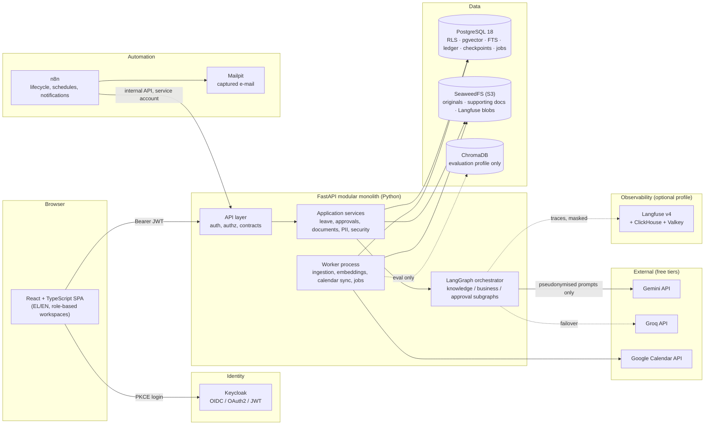

# 00 — Executive Summary

**Document status:** architecture baseline v0.1 (2026-11-04). No application code exists yet.
This package answers brief §16 ("what we expect first"). It is the input to the review the brief
asks for before implementation starts — particularly on RLS, LangGraph persistence, PII protection,
document security and the ChromaDB/pgvector coexistence (all addressed explicitly below and in the ADRs).

## 1. What we are building

A **multilingual (Greek/English), multi-tenant Leave Management AI Assistant** that runs entirely on
a developer machine with Docker Compose. Employees talk to an assistant that:

1. answers questions about *their own company's* leave policies from the company's documents, with citations,
   and says "I don't know" when the documents do not support an answer;
2. retrieves their leave balance and history from the backend (never from the model's imagination);
3. prepares and validates leave requests (working days, holidays, balance, company rules), asks for
   explicit confirmation, and submits them;
4. hands the request to a deterministic approval workflow (manager → HR when the company's rules say so);
5. after final approval, synchronises company/personal Google Calendars and notifies everyone involved;
6. records every step in an audit trail.

The LLM (Gemini primary, Groq failover) **coordinates** the conversation. FastAPI + PostgreSQL **decide**:
identity, tenant, permissions, business rules, balances, approvals, execution, audit. Claude Code is the
development tool only and is not part of the runtime.

## 2. The shape of the solution

## 3. Principles that drive every decision

| # | Principle | Where it bites |
|---|-----------|----------------|
| P1 | **The LLM proposes; the backend disposes.** Every state change goes through *propose → validate → confirm → execute* in deterministic code. | ADR-0009, doc 04 §6 |
| P2 | **Trusted context flows one way.** Tenant, user and roles come from the verified JWT, are injected into the graph as read-only runtime context, and are never model-writable. | ADR-0007, doc 08 §3 |
| P3 | **Defence in depth for tenancy.** Service-layer authorization *and* PostgreSQL RLS *and* tenant-prefixed object keys *and* tenant-partitioned vector search. Any single failure is contained. | ADR-0003 |
| P4 | **Fail closed on sensitive data.** Sick-leave supporting documents never reach a parser, an index, an LLM or Langfuse. Pseudonymisation is a privacy layer, never an authorization substitute. | ADR-0016, ADR-0017 |
| P5 | **Deterministic wherever determinism is possible.** Working days, ledger, approval rules, citation verification, proposal rendering, idempotency — none of these involve a model. | docs 04, 07 |
| P6 | **One orchestrator, modular subgraphs; n8n automates, it does not reason.** | ADR-0007, ADR-0019 |
| P7 | **Boring infrastructure.** PostgreSQL carries relational data, vectors, keyword search, the job queue and graph checkpoints. No Redis, no Celery, no message broker in the core profile. | ADR-0011, ADR-0019 |
| P8 | **Honest documentation.** Nothing is reported as done, measured or proven until it is. | doc 14 |

## 4. Decisions at a glance

| Area | Brief's direction | Baseline decision | Status | ADR |
|------|-------------------|-------------------|--------|-----|
| Deployment | Docker Compose, local only | Compose with **profiles**: `core`, `automation`, `observability`, `eval` | accepted + refined | 0025 |
| LLM providers | Gemini primary, Groq alternative; failover | Provider router with health tracking, error classification, bounded retries; model IDs via env | accepted | 0010 |
| Backend | Python/FastAPI/PostgreSQL/SQLAlchemy/Pydantic | Modular monolith + worker process, layered (API → application → domain → infrastructure) | accepted | 0001, 0002 |
| Identity | Keycloak, OIDC, RBAC, tenant-aware | **Single realm**, tenant claim from group/attribute mapper, platform admins without tenant | accepted + refined | 0004 |
| Tenancy | Shared DB + RLS | RLS with transaction-scoped `SET LOCAL`, non-owner runtime role, `FORCE ROW LEVEL SECURITY`, leak tests | accepted | 0003 |
| Leave balances | Ledger | Append-only ledger; balance = derived view; pending = computed from requests | accepted | 0005 |
| Approvals | Deterministic, configurable | Rule table → approval steps; request state machine with optimistic locking | accepted | 0006 |
| Agent | LangGraph, orchestrator + 3 subgraphs | As specified; approvals by *other* users run in their own session (see §5) | accepted + refined | 0007 |
| Graph persistence | Postgres checkpointer | Separate schema + DB role; thread ownership table; **only pseudonymised state is checkpointed** | accepted + refined | 0008 |
| Tool security | Backend decides | Tool gateway: allowlist per role, Pydantic args, authorization, idempotency keys | accepted | 0009 |
| Object storage | SeaweedFS (S3) | Storage port + S3 adapter; tenant-prefixed keys; envelope encryption for supporting docs | accepted | 0016 |
| Parsing | Docling + OCR | Docling; Tesseract (`ell`,`eng`) as OCR engine | accepted | 0015 |
| Chunking | Hybrid structure-aware | Heading-tree chunking, token-bounded splits, overlap, table-aware | accepted | 0015 |
| Embeddings | `intfloat/multilingual-e5-small` local | As specified (384-d, MIT); prefixes enforced centrally | accepted | 0013 |
| Vector DB | ChromaDB **and** pgvector | `VectorIndex` port; **pgvector default**, Chroma in `eval` profile; default confirmed by evaluation | **modified** | 0011 |
| Retrieval | Hybrid + reranking | pgvector ANN + Postgres FTS (`greek`/`english`) + RRF + local cross-encoder reranker | accepted | 0012, 0014 |
| Grounding | Strict | Citation IDs verified against retrieved set; evidence threshold → "insufficient evidence" path | accepted | 0007 |
| Automation | n8n CE | n8n for lifecycle/schedules/notifications via internal API + outbox polling; heavy work in backend worker | accepted + refined | 0019 |
| PII | Presidio + pseudonymisation | Tenant-scoped pseudonym vault, bidirectional, authorization-gated re-identification | accepted | 0017 |
| Prompt injection | Comprehensive, risk tiers | Layered: ingestion scanner (heuristics + local classifier + optional LLM judge), risk score, per-tenant thresholds, quarantine | accepted | 0018 |
| Calendar | Google Calendar + mock | Outbox-based sync, deterministic event IDs, reconciliation, adapter port | accepted | 0020 |
| Notifications | In-app + simulated e-mail (MailHog) | In-app + e-mail via n8n → **Mailpit** | **modified** | 0021 |
| Frontend | React + TypeScript | Vite, Ant Design, react-oidc-context, react-i18next; zero business logic | accepted | 0024 |
| Observability | Self-hosted Langfuse | Langfuse v4 as **optional profile** (ClickHouse + Valkey + SeaweedFS blobs), masked traces | **modified** | 0022 |
| Testing/eval | Pytest + RAGAS + Langfuse | As specified; security suite runs with scripted fake LLMs; 30-scenario dataset drafted | accepted | 0023 |

## 5. Where I recommend changing the established direction

Each item is argued in full in [doc 14](14-decision-log-and-open-questions.md) and the referenced ADR.
None removes a capability; each is reversible.

1. **Mailpit replaces MailHog** (ADR-0021). MailHog has had no release for years; Mailpit is the maintained
   drop-in (same SMTP port 1025, UI on 8025, plus a REST API that the test suite can use to assert e-mails).
2. **Cross-user approvals are a database state machine, not a paused graph** (ADR-0006/0007). A LangGraph
   interrupt pauses *one user's* run under *that user's* trusted context. Resuming an employee's run with a
   manager's decision would cross security contexts and keep threads open for days. The Approval Subgraph
   therefore handles the *acting* user's confirmation interrupt and controlled execution — for the employee
   (submit) and, separately, for the manager/HR (approve/reject via their own chat or UI). Checkpointing,
   interrupts, resume-after-restart and human-in-the-loop are all still demonstrated.
3. **pgvector is the default retrieval backend; ChromaDB is an evaluation profile** (ADR-0011). Both are
   implemented behind one `VectorIndex` port and compared on the same corpus and dataset as required, but
   only pgvector can sit under RLS, join on document permissions and share a transaction with the keyword
   index. Running two production vector stores would duplicate capability, which the brief forbids.
4. **Langfuse becomes an optional Compose profile** (ADR-0022). Langfuse v4 self-hosting requires
   PostgreSQL + ClickHouse + Redis/Valkey + S3 blob storage. With the core stack this exceeds the 7 GB
   available on the current development machine. It stays self-hosted and is used for every evaluation run,
   but it is not required for the application to function.
5. **No Celery/Redis; a PostgreSQL-backed job queue** (ADR-0019). Ingestion, embedding, calendar sync and
   housekeeping run in a worker process consuming a `jobs` table (`FOR UPDATE SKIP LOCKED`). n8n orchestrates
   lifecycle and schedules through the backend's internal API and an outbox it polls — n8n never does the
   heavy work and the backend never depends on n8n being up.
6. **Valkey instead of Redis for Langfuse** (ADR-0022): BSD-licensed, supported by Langfuse, avoids the
   Redis licence change. SeaweedFS doubles as Langfuse's S3 blob store (one less container).
7. **Greek NER licence caveat** (ADR-0017). Presidio's Greek support uses spaCy `el_core_news_md`, released
   under CC BY-NC-SA 3.0. Acceptable for this non-commercial project; documented as a constraint with a
   swap path (transformers NLP engine) for commercial use.
8. **Python 3.14 with a resolver-verified `uv` lock** (ADR-0026). Verified on 2026-11-04: the whole dependency set
   resolves, installs and imports on 3.14 (3.13 is an identical fallback). The newest *mutually compatible* ML set is
   transformers 4.57 / sentence-transformers 5.7, because Docling and `optimum-onnx` pin `transformers<4.58`; torchvision
   must come from the PyTorch CPU index together with torch.
9. **Single Keycloak realm with tenant claims** (ADR-0004) instead of one realm per company: dynamic tenant
   creation becomes a group + attribute operation through the Admin API; the SPA keeps one OIDC configuration.

## 6. Constraints discovered during verification (2026-11-04)

| Constraint | Consequence in the design |
|------------|---------------------------|
| Development machine: 4 cores, 7.1 GB RAM, no GPU (measured) | Compose profiles; Langfuse/Chroma optional; CPU-sized models (e5-small; int8 reranker); worker can run embedded in the API process on low-memory hosts; explicit RAM budget per container (doc 03 §7). Recommended host for the full stack: 16 GB. |
| Gemini free tier: limits are per project, visible only in AI Studio; third-party reports suggest very low daily quotas for Flash-class models and that **free-tier prompts may be used to improve Google products** (Google pricing page) | Only fictional data; everything pseudonymised before leaving the host; sensitive categories never leave; Groq configured as co-primary during development; aggressive mocking in tests; model IDs are configuration, not code. Quota figures must be read from AI Studio at M6 (R-03). |
| Google OAuth clients in "Testing" publishing status issue refresh tokens that expire after 7 days | Connection health indicator, re-authorisation flow, sync failure classification `AUTH_EXPIRED` (doc 10). |
| Cross-encoder rerankers (bge-reranker-v2-m3, 568M params) are slow on CPU | Rerank ≤ 20 candidates; int8/ONNX export; a lighter candidate (`mmarco-mMiniLMv2-L12`) in the comparison; latency budget in doc 11. |
| PostgreSQL `greek` FTS configuration exists (verified on `pgvector/pgvector:0.8.7-pg18` → PG 18.6, pgvector 0.8.7, and on the pg17 image) but stems aggressively and strips accents | Keyword leg uses `greek` and `english` configs plus `simple`; evaluation measures its contribution. |
| spaCy Greek models are CC BY-NC-SA 3.0 | See §5.7. |

## 7. Roadmap at a glance

| Milestone | Outcome | Depends on |
|-----------|---------|------------|
| M0 Foundation | Repo, tooling, Compose `core` (Postgres, Keycloak, Mailpit), CI, docs skeleton | — |
| M1 Identity & tenancy | Keycloak realm, JWT auth, tenant context, RLS, audit log, seed of two companies, isolation tests | M0 |
| M2 Leave domain | Ledger, working days, holidays, requests, approval engine, state machine, API, TDD suite | M1 |
| M3 Frontend foundation | SPA, login, employee/manager/admin screens for the non-chat flows | M2 |
| M4 Document platform | Storage port + SeaweedFS, upload, versions, Docling, chunking, embeddings, pgvector, FTS, worker/jobs | M1 |
| M5 Content security | Presidio + vault, injection scanner, risk tiers, review/quarantine, supporting documents isolation | M4 |
| M6 Agent core | Provider router + failover, orchestrator + knowledge subgraph, strict grounding, chat API (SSE), checkpointer | M4, M5 |
| M7 Agentic operations | Business + approval subgraphs, tool gateway, interrupts/HITL, idempotent execution, notifications | M2, M6 |
| M8 Integrations & automation | Google Calendar (mock + real), sync outbox, n8n workflows, retention | M7 |
| M9 Observability & evaluation | Langfuse profile, masked tracing, 30-scenario dataset, RAGAS, pgvector vs Chroma, reranker comparison | M7 |
| M10 Hardening & documentation | Platform admin, security policy UI, troubleshooting, final evaluation report, ADR sync | M8, M9 |

A vertical slice ("ask a policy question with citations") is reachable at the end of M6; the headline
scenario from the brief ("how many days do I have, request five days from 14 December") at the end of M7.

## 8. Formerly open questions — now decided

The questions that originally needed your input (leave entitlement semantics, sick-leave review, who approves a
manager's own leave, free-tier terms, evaluation hardware, Google project ownership, seed companies, retention
defaults, manager visibility, chat approvals, organisation shape, tenant bootstrap, CI, chat retention) were decided
on 2026-11-04 by applying the brief's own principles. The decisions, their rationale and where each is applied are
tabulated in [doc 14 §4](14-decision-log-and-open-questions.md#4-open-questions--decided-2026-11-04) and recorded in
ADR-0028 (business rules) and ADR-0029 (operating decisions). Headlines:

- Annual entitlement granted up-front and pro-rated on hire; carry-over 5 days to 31 March; whole days; no negatives.
- Sick leave never routes to managers: ≤ 3 days without document is auto-acknowledged, otherwise HR review.
- A manager's own request goes to the manager override or HR; HR may act as audited fallback approver.
- Free tiers only, fictional data only; Gemini primary with Groq-first available by configuration; no paid tier.
- Evaluation runs on the 7 GB reference machine in an "evaluation session" mode; no larger host required.
- Managers see leave type (never sick-leave reasons or documents); calendars and team views show absence only.
- Chat history: 90 days, owner-only text; HR sees redacted run history, audited.

What remains to supply at implementation time are facts, not decisions: API keys, the Google account/project, and
the free-tier quota numbers read from AI Studio at M6.
