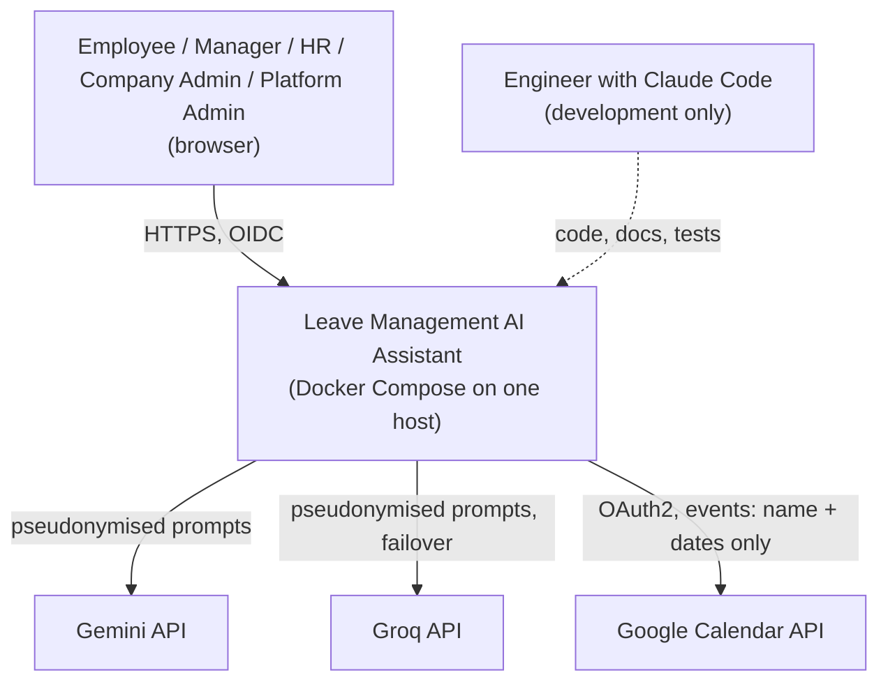
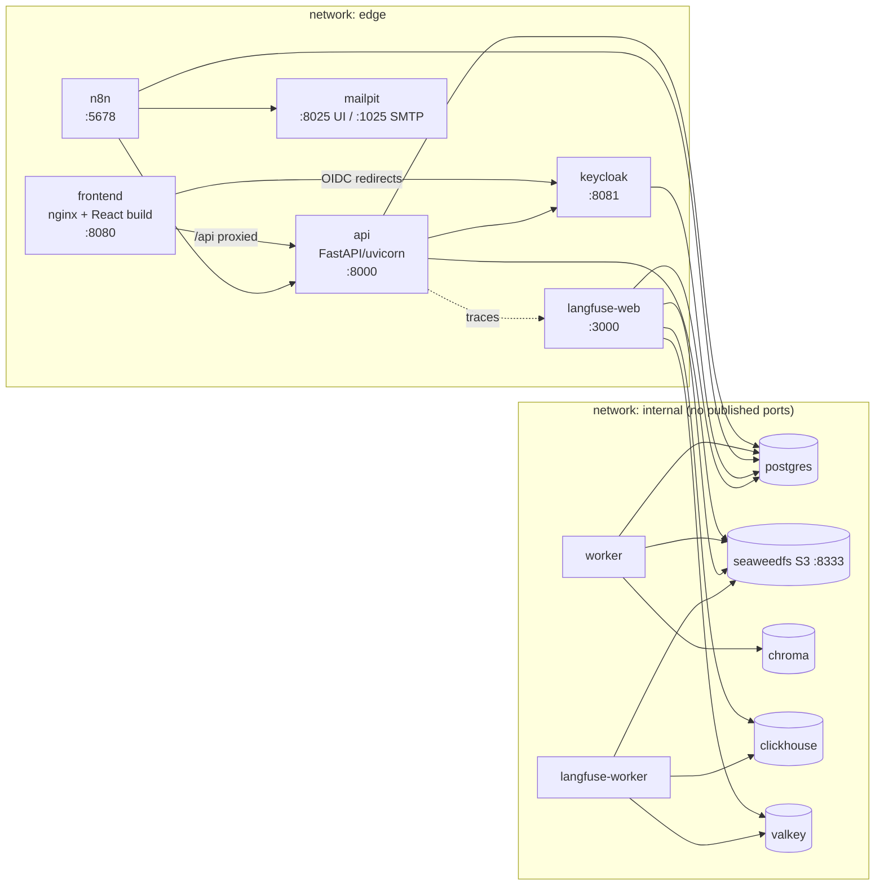
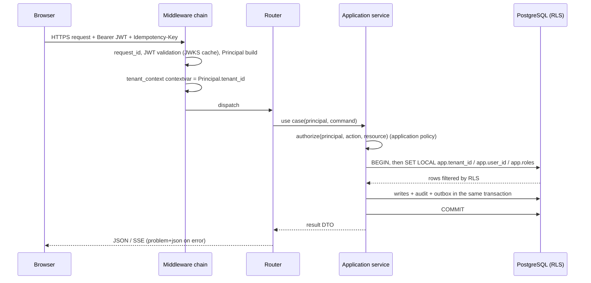
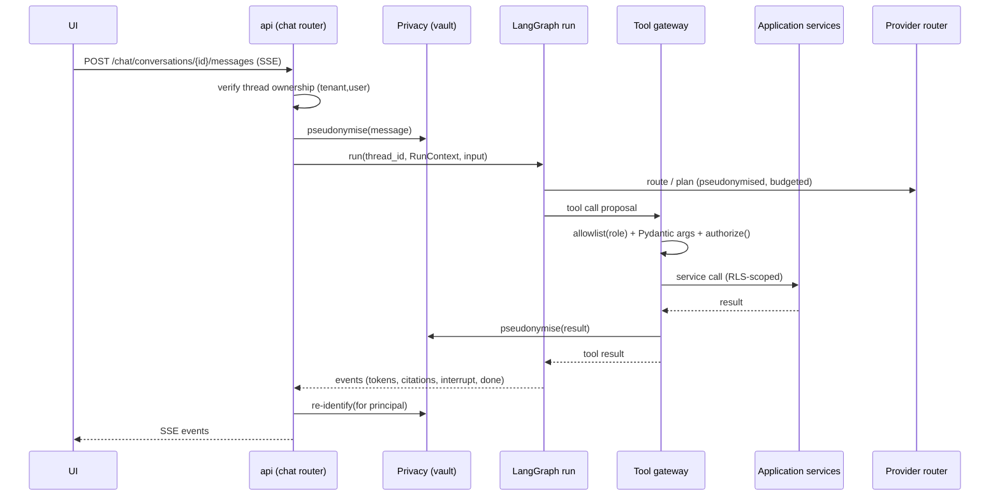
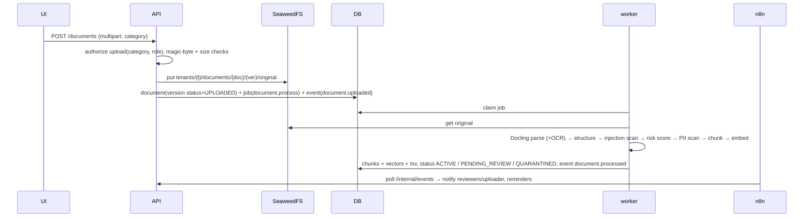
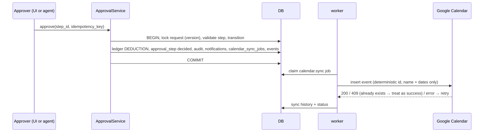

# 03 — System, Component and Deployment Architecture

## 1. Architectural style

- **Modular monolith** (one Python codebase, one image) deployed as two processes: `api` (FastAPI) and
  `worker` (job runner). No microservices, no message broker (ADR-0001). On low-memory hosts the worker can run
  embedded in the API process (`WORKER_MODE=embedded`).
- **Layered / ports-and-adapters** inside the backend (ADR-0002): `api → application → domain`, with
  `infrastructure` implementing ports declared by `application`. Import rules are enforced by `import-linter`.
- **Deterministic core, probabilistic edge.** The agent package depends on application services through the
  tool gateway; application services never depend on the agent.
- **PostgreSQL as the system of record** for business data, documents metadata, chunks + vectors + FTS,
  PII vault, jobs, outbox, notifications, audit, and (separate schema) LangGraph checkpoints.

## 2. System context



## 3. Container view (Compose services)



| Service | Responsibility | Must not do |
|---------|----------------|-------------|
| frontend | Serve SPA; reverse-proxy `/api/*` to `api` (same origin → no CORS in browser) | Business logic |
| keycloak | Authentication, roles, groups/tenant attributes, service accounts, Admin API | Application authorization decisions |
| api | AuthN/Z, API contracts, application services, LangGraph runs, chat streaming, query-time embedding/reranking, PII, injection screening of user input | Long-running CPU work (parsing, bulk embedding) |
| worker | Jobs: document processing, embedding/indexing, re-index, calendar sync, retention scan, housekeeping | Serve HTTP (only a health file) |
| postgres | Everything relational + vectors + FTS + queue + checkpoints + Keycloak/n8n/Langfuse databases | — |
| seaweedfs | Originals, supporting documents (encrypted), Langfuse blobs | Serve files to browsers directly |
| n8n | Lifecycle orchestration, schedules, notification dispatch, operational workflows | Parsing, embedding, business rules, agent logic |
| mailpit | Capture outgoing e-mail | — |
| chroma | Second vector backend for evaluation | Default retrieval |
| langfuse (+clickhouse, valkey) | Traces, experiments, evaluation history | Store un-masked PII or supporting documents |

## 4. Backend component architecture

### 4.1 Package layout
```
backend/
├── pyproject.toml, uv.lock, alembic.ini
├── src/leave_assistant/
│   ├── main.py                    # FastAPI app factory, middleware, routers
│   ├── config.py                  # pydantic-settings (env), profiles, feature flags
│   ├── api/                       # HTTP layer only
│   │   ├── deps.py                # Principal, DB session, services wiring
│   │   ├── errors.py              # RFC 9457 problem details
│   │   ├── routers/               # auth, me, chat, leave, approvals, team, documents, supporting_documents,
│   │   │                          # notifications, calendar, admin/*, platform/*, internal/*, health
│   │   └── schemas/               # request/response models (Pydantic)
│   ├── application/               # use cases; depends on domain + ports; no FastAPI, no SQLAlchemy
│   │   ├── authz/                 # Policy: authorize(principal, action, resource)
│   │   ├── leave/                 # LeaveService, ApprovalService, LedgerService, WorkingDayService
│   │   ├── documents/             # DocumentService, IngestionService, RetentionService, ReviewService
│   │   ├── retrieval/             # RetrievalService (hybrid + rerank), ContextBuilder
│   │   ├── privacy/               # PseudonymisationService, ReidentificationPolicy
│   │   ├── security/              # InjectionScanService, RiskScoring, DocumentRiskPolicy
│   │   ├── calendar/              # CalendarSyncService, ReconciliationService
│   │   ├── notifications/         # NotificationService (records + outbox events)
│   │   ├── tenancy/               # TenantProvisioningService (Keycloak + DB), TenantContext
│   │   ├── jobs/                  # JobService (enqueue), job handlers registry
│   │   ├── audit/                 # AuditService
│   │   └── ports.py               # Protocols: DocumentStorage, VectorIndex, CalendarProvider, LLMProvider,
│   │                              # EmbeddingModel, Reranker, DocumentParser, PiiEngine, InjectionClassifier,
│   │                              # IdentityAdmin, Clock, IdGenerator
│   ├── domain/                    # pure Python: entities, value objects, rules, state machines, errors
│   │   ├── leave/                 # LeaveRequest, LeaveType, Ledger, WorkingDays, ApprovalRules, StateMachine
│   │   ├── documents/             # Document, Version, Chunk, Category, RiskTier, Lifecycle
│   │   ├── tenancy/               # Tenant, Department, Employee, Role, Principal
│   │   └── privacy/               # Placeholder, EntityType, ReidentificationScope
│   ├── infrastructure/            # adapters implementing ports
│   │   ├── db/                    # SQLAlchemy models, session factory, RLS context, repositories, migrations
│   │   ├── storage/               # S3DocumentStorage (SeaweedFS), LocalFsStorage (tests), envelope crypto
│   │   ├── identity/              # Keycloak JWKS validation, Admin API client
│   │   ├── llm/                   # GeminiProvider, GroqProvider, ProviderRouter, FakeProvider (tests)
│   │   ├── ml/                    # E5Embedder, CrossEncoderReranker, ModelRegistry (lazy loading)
│   │   ├── parsing/               # DoclingParser (+Tesseract), StructureAwareChunker
│   │   ├── vector/                # PgVectorIndex, ChromaIndex
│   │   ├── privacy/               # PresidioEngine (+ Greek recognisers), VaultRepository
│   │   ├── security/              # HeuristicInjectionDetector, LocalClassifier, LlmJudge (optional)
│   │   ├── calendar/              # GoogleCalendarProvider, MockCalendarProvider
│   │   ├── notifications/         # renderers (i18n templates)
│   │   └── observability/         # structlog config, Langfuse handler + masking, request context
│   ├── agent/                     # LangGraph
│   │   ├── graph.py               # orchestrator StateGraph
│   │   ├── state.py, context.py   # typed state, trusted RunContext
│   │   ├── subgraphs/             # knowledge.py, business.py, approval.py
│   │   ├── tools/                 # tool specs (Pydantic args) + ToolGateway
│   │   ├── prompts/               # versioned prompt files (md + yaml front-matter)
│   │   ├── checkpoint.py          # AsyncPostgresSaver wiring (separate pool/role)
│   │   └── runner.py              # run/resume API used by the chat router (SSE event mapping)
│   └── worker/                    # job loop (SKIP LOCKED), handlers, graceful shutdown
├── alembic/versions/
└── tests/ (unit/ integration/ security/ agent/ e2e/ eval/)
```

### 4.2 Dependency rules (import-linter contracts)
1. `domain` imports nothing from the other layers.
2. `application` imports `domain` and `application.ports` only (no SQLAlchemy, FastAPI, boto3, LangGraph).
3. `infrastructure` imports `application.ports` + `domain`; adapters are wired in `api/deps.py` and `worker`.
4. `agent` imports `application` (services via the gateway) and `infrastructure.llm`; `application` never imports `agent`.
5. `api` imports `application` and `agent.runner`; never `infrastructure` directly except through wiring.

### 4.3 Ports (interfaces) and adapters
| Port | Methods (sketch) | Adapters |
|------|------------------|----------|
| `DocumentStorage` | `put(key, stream, meta)`, `get(key)`, `delete(key)`, `exists`, `list(prefix)` | S3 (SeaweedFS), local FS (tests) |
| `VectorIndex` | `upsert(tenant, chunks)`, `delete_document_version(tenant, id)`, `search(tenant, query_vec, k, filter)` | pgvector, Chroma |
| `KeywordIndex` | `search(tenant, text, lang, k, filter)` | Postgres FTS (only implementation) |
| `EmbeddingModel` | `embed_queries([...])`, `embed_passages([...])`, `model_id`, `dim` | e5-small |
| `Reranker` | `score(query, [passages]) -> [float]`, `model_id` | bge-m3, mMiniLM, identity (tests) |
| `DocumentParser` | `parse(bytes, mime, ocr_langs) -> ParsedDocument` | Docling |
| `PiiEngine` | `analyze(text, lang) -> [Entity]` | Presidio |
| `InjectionClassifier` | `score(text, lang) -> float` | heuristic, local model, LLM judge |
| `LLMProvider` | `invoke(request) -> LLMResponse`, `stream(...)`, `name`, `model` | Gemini, Groq, Fake |
| `CalendarProvider` | `create_event`, `update_event`, `delete_event`, `list_events(private_prop)` | Google, Mock |
| `IdentityAdmin` | `create_user`, `disable_user`, `assign_roles`, `set_tenant` | Keycloak Admin API, Fake |
| `Clock`, `IdGenerator` | deterministic in tests | — |

### 4.4 Request lifecycle (API)

- One `AsyncSession` per request; the `after_begin` hook issues `SET LOCAL` from the contextvar; connections
  are returned with `rollback` reset so no setting survives (ADR-0003).
- Errors map to RFC 9457 `application/problem+json` with stable `type` URIs.
- `Idempotency-Key` header is required on POST/PUT/DELETE that change state; stored per tenant + user + route.

### 4.5 Worker and jobs
- `jobs(id, tenant_id, type, payload, status, attempts, max_attempts, run_after, locked_by, locked_at,
  last_error, created_at)`; claim with `SELECT … FOR UPDATE SKIP LOCKED`; handlers are idempotent; exponential
  backoff; dead-letter status `FAILED` visible in the admin UI; heartbeat renews locks.
- Each handler runs under the job's tenant context (`SET LOCAL app.tenant_id` from the job row) — the worker
  role is still an RLS-bound role; a job can never touch another tenant.
- Job types: `document.process`, `document.reindex`, `calendar.sync`, `retention.scan`, `retention.delete`,
  `checkpoint.cleanup`, `notification.render` (optional), `eval.index_chroma` (eval profile).

### 4.6 Transactional outbox and n8n
Side effects that leave the database (e-mail, n8n orchestration, calendar) are recorded as rows in
`integration_events` within the business transaction. The worker (calendar) and n8n (lifecycle, notifications)
consume them. Nothing calls n8n synchronously; if n8n is down, events wait (ADR-0019).

## 5. Key runtime flows

### 5.1 Chat turn


### 5.2 Document upload and processing


### 5.3 Final approval side effects


## 6. Deployment architecture

### 6.1 Compose layout
```
deploy/
├── compose.yaml                 # all services with profiles
├── compose.dev.yaml             # bind mounts, hot reload, published debug ports
├── .env.example                 # every variable documented
├── postgres/init/               # 01-databases.sql (keycloak, n8n, langfuse), 02-roles.sql, 03-extensions.sql
├── keycloak/realm-export.json   # realm, clients, roles, mappers, seed users (dev passwords)
├── seaweedfs/                   # s3 config (access keys, buckets)
├── n8n/                         # init container script: import workflows from ../automation/n8n/workflows
├── nginx/                       # frontend server + /api reverse proxy
└── langfuse/                    # env for ClickHouse/Valkey/S3 (profile observability)
```

### 6.2 Profiles
| Profile | Services | When |
|---------|----------|------|
| `core` | postgres, keycloak, seaweedfs, mailpit, api, worker, frontend | always |
| `automation` | n8n (+ init import) | M8 onwards; needed for e-mail dispatch and lifecycle notifications |
| `observability` | langfuse-web, langfuse-worker, clickhouse, valkey | evaluation sessions; optional otherwise |
| `eval` | chroma | retrieval comparison runs |

### 6.3 Networks, ports, volumes
- `edge` (published ports: 8080 frontend, 8081 keycloak, 5678 n8n, 8025 mailpit, 3000 langfuse) and
  `internal` (no published ports). `api` is reachable from the browser only through the frontend proxy in the
  default setup; `compose.dev.yaml` publishes 8000 for tooling.
- Volumes: `pgdata`, `seaweed`, `models`, `n8n`, `chroma`, `clickhouse`, `mailpit`.
- Healthchecks on every service; `depends_on: condition: service_healthy`; Keycloak starts after postgres;
  api after keycloak + postgres + seaweedfs; worker after api (migrations run once in an `migrate` init service).

### 6.4 Secrets and configuration
- All configuration via environment variables (pydantic-settings) documented in `.env.example`.
- Secrets (DB passwords, Keycloak admin, S3 keys, Gemini/Groq keys, Google OAuth client, encryption keys) via
  `.env` (local) or Docker secrets files; never in images or git.
- Encryption keys: `APP_KEK` (32-byte base64) for envelope encryption of supporting documents and OAuth refresh
  tokens; rotation procedure documented in operations docs.

### 6.5 Backup and restore
- `pg_dump` per database + SeaweedFS volume snapshot; documented script `scripts/backup.sh`. Restore tested in M10.

## 7. Cross-cutting concerns

| Concern | Decision |
|---------|----------|
| Time | Store timestamps in UTC; leave dates are civil dates (`date`), interpreted in the tenant's timezone (`tenants.timezone`); working-day arithmetic is date-based. |
| Identifiers | UUIDv7 for all primary keys (time-ordered, generated in the application via `IdGenerator`). |
| Idempotency | `idempotency_keys(tenant, user, route, key, request_hash, response, created_at)`; replay returns the stored response; mismatch → 409. Tools use the same table with `route = tool:<name>`. |
| Concurrency | Optimistic locking (`version` column) on requests, documents, approval steps; `SELECT … FOR UPDATE` for ledger postings per employee+type. |
| i18n | Backend messages and notification templates keyed; rendered per user locale (EL/EN); the assistant is instructed with the detected language and the UI language as fallback. |
| Logging | structlog JSON; fields: `request_id`, `tenant_id`, `user_id` (opaque), `thread_id`, `job_id`; PII scrubbing processor; no prompt bodies in logs (Langfuse holds masked prompts). |
| Errors | Domain errors → typed exceptions → problem details; never leak stack traces; security denials are logged to audit. |
| Caching | JWKS (TTL), tenant config (short TTL, invalidated on change), ML models (process-lifetime). No distributed cache. |
| Feature flags | `RETRIEVAL_BACKEND=pgvector|chroma`, `RERANKER_MODEL`, `INJECTION_LLM_JUDGE=on|off`, `CALENDAR_PROVIDER=google|mock`, `WORKER_MODE=separate|embedded`, `LANGFUSE_ENABLED`, `LLM_PROVIDER_ORDER=gemini,groq`. |

## 8. Frontend structure

```
frontend/
├── src/
│   ├── app/            # router, providers (auth, query, i18n, theme), layout shell, role guards
│   ├── auth/           # oidc-client-ts config, token access, Principal hook
│   ├── api/            # generated OpenAPI client (openapi-typescript + fetch), SSE helper
│   ├── i18n/           # el/en resources; key completeness test
│   ├── features/
│   │   ├── chat/       # conversation list, message stream, citation drawer, confirmation card (interrupt)
│   │   ├── leave/      # balance widget, request form/wizard, history table
│   │   ├── approvals/  # pending approvals, decision dialog, request detail
│   │   ├── team/       # department overview, availability calendar
│   │   ├── documents/  # library, upload, versions, review queue, quarantine actions
│   │   ├── supporting/ # HR-only supporting documents viewer with audit notice
│   │   ├── notifications/
│   │   ├── calendar/   # connection status, authorise, reconciliation (admin)
│   │   ├── admin/      # employees, departments, roles, policies, holidays, approval rules, retention, security thresholds, calendar config
│   │   └── platform/   # tenants, platform config, security policy defaults
│   └── shared/         # UI primitives, formatting (dates per locale), error boundary
├── e2e/ (Playwright)
└── vite.config.ts
```
- Routes are gated by roles from the token *for UX only*; every API call is authorised server-side (FR-UI-04).
- Chat uses `fetch` + `ReadableStream` to consume SSE events: `token`, `tool`, `citation`, `interrupt`, `error`, `done`.
- The confirmation card posts to `/chat/conversations/{id}/resume` with the proposal ID and decision.
- Dates render in the user's locale; leave dates never undergo timezone conversion.
