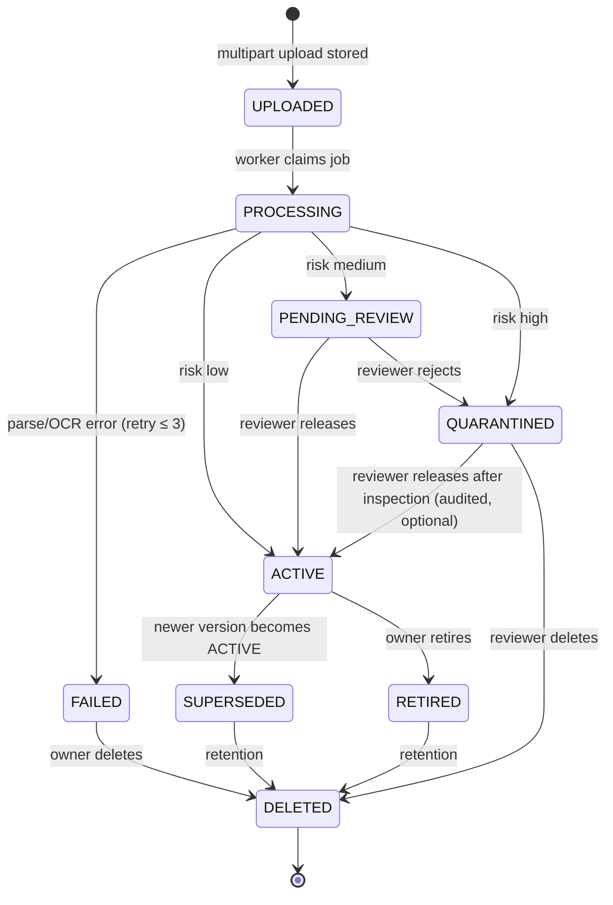
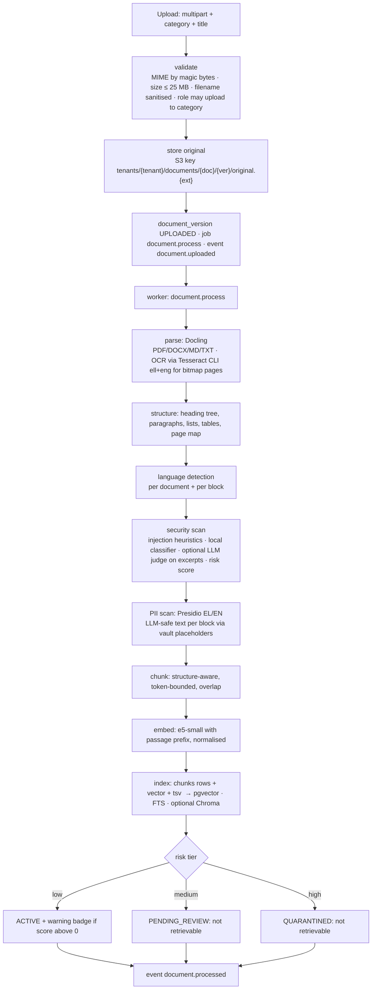
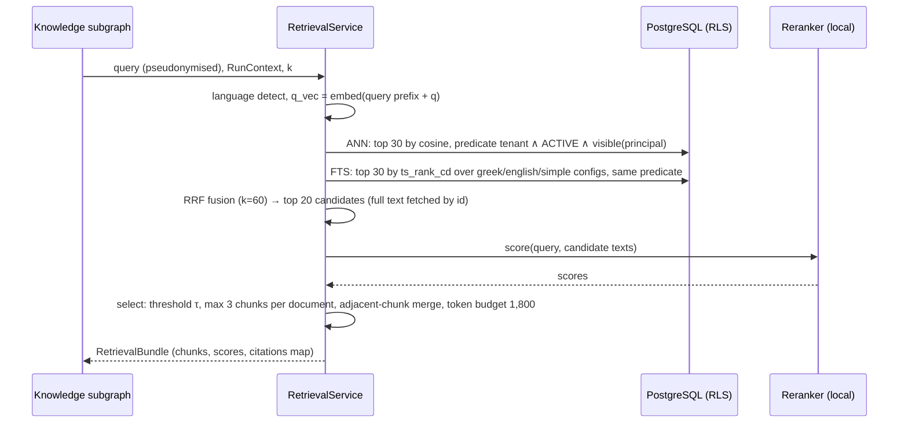

# 05 — RAG, Document Processing and Ingestion

Covers brief §7 (document intelligence) and the Python side of §8 (n8n orchestrates; Python parses, chunks,
embeds, secures, retrieves). ADRs: 0011 (retrieval backend), 0012 (hybrid search), 0013 (embeddings),
0014 (reranker), 0015 (Docling + chunking), 0016 (storage), 0027 (document permissions).

## 1. Document model

### 1.1 Categories and visibility (proposal for brief §9.5 "permission model not finalised")
| Category | Typical content | Readable by | Uploaded / managed by | Reviewer for medium/high risk |
|----------|-----------------|-------------|-----------------------|-------------------------------|
| `policy_general` | Leave policy, holiday notices, how-to guides, FAQ | all tenant roles | HR Administrator, Company Administrator | Company Administrator (general), HR Administrator (HR-authored) |
| `policy_hr_restricted` | Exceptional-case guidelines, HR procedures, approval playbooks | HR Administrator, Company Administrator | HR Administrator | HR Administrator |
| `department_notice` | Department-specific schedules, blackout periods | members of the department, its manager, HR, Company Admin | Manager (own department) **[P3]**, HR Administrator | Company Administrator |
| `admin_internal` | Configuration notes, audit guidance | Company Administrator | Company Administrator | Company Administrator |
| `supporting_document` | Sick-leave medical notes | owner employee, HR Administrator | Employee (own request) | n/a — never processed (doc 08 §9) |

- Visibility is category-based with optional per-document ACL overrides (`document_acl`: grant to role,
  department or employee). ACLs can only *narrow* or *extend within the same tenant*; HR-restricted content can
  never be opened to employees by ACL (hard rule in the policy layer).
- Managers never see `policy_hr_restricted` (brief §4.5). Platform Administrators see no documents.
- Retrieval = tenant filter (RLS) ∧ `status = ACTIVE` ∧ visibility(category, ACL, principal). Both the SQL
  predicate and the application policy are applied (defence in depth).

### 1.2 Versions and languages
A *document* is a logical item (title, category, owner); each upload creates a *version* (file, checksum,
parsed structure, chunks, risk assessment, status). Exactly one version is `ACTIVE`; earlier versions are
`SUPERSEDED` and not retrievable. Language is detected per version and per chunk (documents may mix EL/EN).

## 2. Document lifecycle


Only `ACTIVE` versions are indexed for retrieval. Chunks of non-active versions remain in the database
(flagged) until deletion so that past answers' citations can still be audited.

## 3. Ingestion pipeline



Step details:
- **validate**: allowed MIME set (`application/pdf`, DOCX, `text/plain`, `text/markdown`), magic-byte check,
  size limit (configurable per tenant), file name normalised, duplicate detection by SHA-256 within the document.
- **parse**: Docling `DocumentConverter` with `PdfPipelineOptions(do_ocr=True, ocr_options=TesseractCliOcrOptions(lang=["ell","eng"]), do_table_structure=True)`.
  Docling decides per page whether OCR is needed (bitmap-only pages). DOCX and Markdown go through Docling's native
  backends; TXT is wrapped as a single section. Parsing runs with a per-document CPU time limit (default 15 min) and
  memory guard; failures retry up to 3 times with backoff, then `FAILED` with a user-visible reason.
- **structure**: Docling's document tree is normalised into `Block{type: heading|paragraph|list_item|table|caption,
  level, text, page, bbox?, heading_path[]}`. Tables are exported as Markdown (header + rows) and also kept as
  structured cells for later features.
- **security scan** and **PII scan**: doc 08 §8 and §7. The scan runs on extracted text *before* chunking so
  the risk decision is document-level; chunk-level flags are stored too.
- **chunk / embed / index**: §4–§5. Indexing is transactional per version: all chunks and vectors are written,
  then the version status flips; a failure leaves no partial index.

## 4. Structure-aware chunking (brief §7.4)

Algorithm (deterministic, unit-tested with Greek and English fixtures):
1. Walk the block tree; maintain the `heading_path` (e.g., `Leave Policy > 3. Annual leave > 3.2 Carry-over`).
2. Form *sections* = consecutive blocks under the same lowest heading.
3. Tokenise with the **e5 tokenizer** (the same one used for embedding; e5-small accepts 512 tokens).
4. Target chunk size **300 tokens**, hard max **450**, min **60**:
   - a section ≤ 450 tokens → one chunk;
   - larger sections are split at paragraph/list-item boundaries, then at sentence boundaries, with a
     **40-token overlap** taken from the previous chunk's last sentences (overlap only within a section);
   - sections < 60 tokens are merged with the following sibling under the same parent heading (never across
     top-level headings).
5. Tables: a table ≤ 450 tokens is one chunk (type `table`); larger tables are split by rows with the header row
   repeated in every chunk.
6. Each chunk text is prefixed for embedding with a **context header** `"{document title} > {heading_path}\n"`
   (improves retrieval of short policy clauses); the stored `content` keeps the original text, and citations
   display heading path and page.
7. Chunk identity: `chunk_id = uuid5(version_id, ordinal)`; metadata: `heading_path`, `page_start/end`,
   `chunk_type`, `language`, `token_count`, `risk_flags`, `has_pii`.

Why not fixed-size: policy documents are hierarchical; retrieval must return the *clause* with its heading, and a
single table row without its header is useless (brief §7.4 explicitly rejects naive fixed-size splitting).

## 5. Embeddings (brief §7.5, ADR-0013)

- Model `intfloat/multilingual-e5-small` (MIT, 384-d, 512-token input, Greek and English covered), loaded with
  `sentence-transformers`, CPU, fp32 (int8 optional), normalised embeddings → cosine distance.
- Prefix discipline enforced in one place (`EmbeddingModel` adapter): `passage: ` at indexing, `query: ` at search.
  Tests fail if a caller passes already-prefixed text.
- `embedding_model_id` (name + revision + dim) is stored per chunk and per index generation. Changing the model
  triggers `document.reindex` jobs that build a new generation; the tenant's active generation is switched
  atomically when complete (old generation rows deleted afterwards).
- Batch size 32; the worker embeds; the API embeds only queries.

## 6. Retrieval (brief §7.7, ADR-0012)



### 6.1 Vector leg (pgvector)
- `document_chunks.embedding vector(384)` with `CREATE INDEX … USING hnsw (embedding vector_cosine_ops)`;
  `SET LOCAL hnsw.ef_search = 80` for recall; partial index on active chunks.
- Permission predicate is part of the SQL (join to `document_versions`/`documents` + `document_acl`), and RLS
  applies on top. The query runs inside the request transaction with `SET LOCAL app.tenant_id`.

### 6.2 Keyword leg (PostgreSQL FTS)
- Generated columns: `tsv_el = to_tsvector('greek', content)`, `tsv_en = to_tsvector('english', content)`,
  `tsv_simple = to_tsvector('simple', content)` with GIN indexes. `greek` strips accents and stems aggressively
  (verified: "εργαζόμενοι" → "εργαζομεν"); `simple` catches exact tokens, codes and names.
- Query: `websearch_to_tsquery(cfg, q)` for the detected language config plus `simple`; `ts_rank_cd` for ranking.
  **Amended M9 (2026-11-06):** the language-config leg ORs the stemmed terms (`plainto_tsquery` with `&` rewritten to
  `|`); `simple` keeps `websearch_to_tsquery`. `websearch_to_tsquery`/`plainto_tsquery` AND every word, and a whole
  natural-language question almost never has all its words in one chunk. The leg returned nothing, and hybrid
  ranked exactly like vector-only on all 49 dataset queries (`docs/evaluation/retrieval-comparison.md` §4). The rank
  still prefers chunks that match more terms.
  Greek queries are also normalised (accent folding via `unaccent` where the config does not) so that
  "άδεια" and "αδεια" match.

### 6.3 Fusion and reranking
- Reciprocal Rank Fusion: `score = Σ 1/(60 + rank_i)` across legs; ties broken by vector similarity.
- Reranker: cross-encoder on (query, chunk text with heading header); candidates ≤ 20; int8 ONNX export when the
  latency budget requires it. Model chosen in M9 between `BAAI/bge-reranker-v2-m3` (quality) and
  `cross-encoder/mmarco-mMiniLMv2-L12-H384-v1` (speed) using nDCG@5 / MRR on the evaluation set in **both languages**
  and the measured p95 latency on the reference machine (ADR-0014). Jina rerankers are excluded (non-commercial licence).
  **Decided in M9 (2026-11-06): candidate B on ONNX fp32** (`RERANKER_BACKEND=onnx`; exported by `make models` into
  `/models/onnx/<model>`, `safe_tanh` applied before export). Same scores as PyTorch, rerank p50 1.88 s vs 2.72 s.
  A is better (+0.034 nDCG@5) but about 13× slower per turn excluding LLM time (35.4 vs 2.6 s); int8 is slower than fp32 on the AVX-only CPU. The
  backends are `torch | onnx | onnx-int8`. 10 candidates at 256 tokens stay (ADR-0014, retrieval comparison §3).

### 6.4 Evidence threshold
`τ` is a calibrated reranker score (per model) below which a chunk is not considered evidence; if fewer than
`min_evidence_chunks` (default 1) pass, the Knowledge subgraph answers "insufficient evidence" (doc 04 §4).

### 6.5 Context builder
- Orders selected chunks by document then ordinal; merges adjacent chunks of the same version; caps 3 chunks per
  document for diversity; enforces the 1,800-token context budget; emits `<document id="n" …>` blocks using the
  **LLM-safe (pseudonymised) text**; builds the citation map `n → {document_id, version_id, chunk_id, title,
  heading_path, page}` returned to the UI after verification.

### 6.6 Cross-lingual behaviour
Queries in Greek retrieve English documents and vice versa (e5 is cross-lingual; the FTS leg contributes only
same-language matches). The answer is generated in the user's language from mixed-language evidence; citations
keep the source language. Evaluation measures both directions (doc 11).

### 6.7 M6 implementation notes (2026-11-05, worklog M6)
- `RetrievalService.retrieve` (agent path) takes the best fused candidates and rescores them with the cross-encoder
  on `title: content_llm_safe` against the pseudonymised query; `search` (documents page) is unchanged.
  **Deviation: 10 candidates (`RERANK_CANDIDATES`) and a 256-token pair length (`RERANK_MAX_LENGTH`)** instead of
  20 / 512. Reranking was the only expensive stage of a chat turn on the reference CPU (7–8 s for 17 pairs); halving
  both brought the turn excluding LLM time from p50 6.19 s to 3.12 s (NFR-PERF-01, worklog M6). S01–S09 retrieve
  the expected section in the top 3 either way. M9 revisits both with the evaluation harness.
- Reranker port with a sentence-transformers `CrossEncoder` adapter (sigmoid scores 0–1). **Running default:
  candidate B** (`cross-encoder/mmarco-mMiniLMv2-L12-H384-v1`) — candidate A (`BAAI/bge-reranker-v2-m3`, fp32 ≈ 2.2 GB)
  does not fit the api's 2–3 GB limit next to e5 and Presidio on the reference host; A is downloaded by `make models`,
  smoke-tested and measured; the selection stays an M9 decision (ADR-0014).
- `ContextBuilder` (`application/retrieval/context.py`) implements §6.5; τ (`RETRIEVAL_TAU`) and
  `MIN_EVIDENCE_CHUNKS` are settings. **Provisional calibration for candidate B: τ = 0.5, one evidence chunk.**
  **Recalibrated in M9: τ = 0.22** (`RETRIEVAL_TAU`). It maximises balanced accuracy of the top score, answerable
  vs unanswerable, over the 45 dataset items (0.985; highest unanswerable 0.199). At 0.5, 15 % of answerable
  questions were refused. P02 (dress code) now ends as insufficient evidence; S01–S09 pass.
  Measured top scores: answerable S01–S09 questions 0.65–1.00, unanswerable ones ≤ 0.06, off-topic "policy"
  questions 0.31 (pets) and 0.51 (dress code). The dress-code probe passes τ, so the generation prompt's
  "say you don't know" rule is the second line of defence there (scenario P02 is a live probe). Each cited source
  is the best-scoring chunk of its merged group, not the first one.
- The reranker and the embedder rewrite `tanh` as `2·sigmoid(2x) − 1` at load (`infrastructure/ml/safe_tanh.py`)
  and e5 drops BERT's unused pooler. MKL's vector `tanh` kernel crashed with SIGILL on the AVX-only reference CPU
  (doc 13 R-27). Scores and vectors are unchanged (max difference 1.5e-8 and 0).

## 7. The `VectorIndex` port and the ChromaDB comparison (brief §7.6, ADR-0011)

```python
class VectorIndex(Protocol):
    def upsert(self, tenant_id: UUID, generation: str, items: list[ChunkVector]) -> None: ...
    def delete_version(self, tenant_id: UUID, version_id: UUID) -> None: ...
    def search(self, tenant_id: UUID, generation: str, query: list[float], k: int,
               allowed_version_ids: set[UUID] | None) -> list[Hit]: ...
```
- **pgvector adapter** (default): search runs as SQL with the permission predicate inline; participates in RLS and
  in the request transaction; FTS shares the table.
- **Chroma adapter** (`eval` profile): one collection per tenant and generation (`t_{tenant}_{generation}`); the
  permitted `version_id` set is computed in PostgreSQL first and passed as a `where: {"version_id": {"$in": […]}}`
  filter — tenant isolation here is *application-enforced only*, which is why it is not the default.
- The evaluation harness (`evaluation/retrieval_compare.py`) indexes the same corpus with the same embeddings into
  both, runs the same query set, and reports hit@k, MRR, nDCG@k and latency per backend, with and without the
  reranker. The default stays pgvector unless Chroma shows a *material* quality advantage — which the design
  does not expect, since both store identical vectors and differ only in ANN implementation. The brief asks for
  the default to be justified by results: the report is `docs/evaluation/retrieval-comparison.md`.
- **As built (M9, 2026-11-06):** the port is `VectorIndex.search(uow, embedding, *, reader, limit) -> list[LegHit]`
  (`application/ports.py`). `PgVectorIndex` delegates to the repository's SQL; `ChromaVectorIndex` uses one
  collection per tenant (`tenant_<hex>`, cosine), takes the allow list from `ChunkRepository.visible_version_ids(reader)`
  under RLS, and filters on it. `ChromaSync.sync_tenant` rebuilds a tenant's collection from the pgvector rows
  (`index_rows`), so both stores hold identical vectors. Ingestion writes only to pgvector; Chroma is synced for an
  evaluation run. The harness is `leave_assistant.evaluation.retrieval` (not `retrieval_compare.py`). Result:
  identical rankings, Chroma slower; **pgvector stays the default** (ADR-0011).

## 8. Re-indexing and document updates
- New version uploaded → full pipeline → on `ACTIVE`, previous version → `SUPERSEDED` in the same transaction;
  its chunks are flagged `retrievable = false`.
- Metadata-only edits (title, category, ACL) do not re-embed; visibility changes take effect immediately via the
  predicate.
- Embedding model or chunking-rule change → bump `index_generation`; `document.reindex` jobs rebuild active
  versions; n8n's W2 triggers and reports (doc 06).
- Deletion: object storage delete + chunk/vector delete + audit; Chroma deletion by `version_id` filter.

## 9. Supporting documents are not part of this pipeline
Sick-leave supporting documents use a separate storage prefix, are encrypted at rest with per-file keys, are never
parsed, chunked, embedded, scanned by the LLM judge, traced or sent anywhere (doc 08 §9). The document pipeline
rejects the `supporting_document` category by construction (type system, not configuration).

## 10. Seed corpus (two fictional companies)
| Tenant | Documents (EL = Greek, EN = English) |
|--------|--------------------------------------|
| Aegean Logistics S.A. (Piraeus; Greek-first) | Κανονισμός Αδειών (EL, PDF), Leave Policy (EN translation, DOCX), Αργίες 2026 (EL, MD), Διαδικασία Αναρρωτικής Άδειας (EL, PDF **scanned** for OCR), HR-restricted: Οδηγός Εξαιρέσεων (EL, DOCX), FAQ (EL/EN mixed, MD) |
| Brightwater Software Ltd. (English-first) | Employee Leave Handbook (EN, PDF), Public Holidays 2026 (EN, MD), Sick Leave Procedure (EN, DOCX), HR-restricted: Exceptional Leave Guidelines (EN, PDF), Department notice: Release freeze dates (EN, TXT) |
| Both | One adversarial document per tenant containing prompt-injection payloads (expected: quarantined), one near-duplicate version pair (expected: superseded) |

All seed documents are fictional and written for the project; their facts are the ground truth for the
evaluation dataset (doc 11 §6).

## 10a. M4 implementation notes (2026-11-05)
- Uploads (`POST /documents`, `POST /documents/{id}/versions`) are multipart; the API spools the part to a temporary
  file while enforcing `MAX_UPLOAD_MB`, sniffs the type by magic bytes in pure Python (PDF header, ZIP container with
  `word/document.xml`, UTF-8 text without NUL bytes), computes the SHA-256, stores the original under the ADR-0016 key,
  then writes the document/version rows, the audit entry, the `document.uploaded` outbox event and the
  `document.process` job in one transaction. Duplicate content within a document is refused (`document/duplicate-content`).
- Jobs live in `platform.jobs` (no RLS; identifiers only in payloads); the worker claims across tenants with
  `FOR UPDATE SKIP LOCKED` and every handler opens a tenant-scoped transaction. ML handlers run in a **child process**
  (`python -m leave_assistant.worker.run_job <job_id>`) with a wall-clock timeout and heartbeat renewal, in both worker
  modes; the API process loads only the e5 model (query embeddings).
- The pipeline is implemented as specified: Docling (`TesseractCliOcrOptions(lang=["ell","eng"])`, table structure)
  → `Block` tree → language (lingua restricted to EL/EN) → **no-op risk and PII scanners until M5** (tier `low`,
  `content_llm_safe = content`) → structure-aware chunking with the e5 tokenizer → e5 passages → chunks + vectors +
  generated tsvectors written and the version activated (previous active version `SUPERSEDED`, chunks flagged) in
  one transaction. Failures retry up to three times with backoff; the final failure marks the version `FAILED`,
  audits `document.failed` and notifies the uploader.
- FTS: `tsv_simple` is generated over `app.f_unaccent(content)` (an IMMUTABLE wrapper around `unaccent`, required for
  generated columns) so unaccented Greek queries match; `greek`/`english` configurations provide stemming.
- Retrieval in M4 = vector leg (HNSW, `ef_search = 80`) + keyword leg, both with the visibility predicate inline,
  RRF (k = 60) over the top 30 of each, ≤ 3 chunks per document; the reranker (ADR-0014) and the token-budget
  context builder arrive with M9/M6. `GET /documents/search` exposes the fused hits; `GET /documents/citations/{chunk_id}`
  serves the citation drawer.
- Re-indexing: `index_generation = "{embedding_model_id}|{chunking_rules_version}"`; `document.reindex` jobs rebuild
  chunks from the stored `extracted.json` without re-parsing (`make reindex`).
- Seed corpus (§10) without the adversarial pair (M5): rendered from Markdown sources by `backend/scripts/build_corpus.py`
  (PDF via fpdf2, DOCX via python-docx, scanned PDF as page images for the OCR path) and uploaded by the seed through
  `DocumentService`; the Brightwater handbook has two versions (v1 "25 days" superseded by v2 "20 days").

## 11. Failure handling and limits
| Situation | Behaviour |
|-----------|-----------|
| Unsupported or spoofed MIME | 415 at upload; audit |
| Parse exception / OCR timeout | retry ×3 with backoff; then `FAILED` with reason; uploader notified |
| Empty text after parsing (e.g., image-only PDF with OCR failure) | `FAILED: no_text`; suggest re-scan |
| Oversized document (> 25 MB or > 500 pages) | rejected at upload (configurable) |
| Embedding model unavailable | job retried; API degrades to FTS-only retrieval with a warning flag in traces |
| Chroma unavailable (eval profile) | pgvector unaffected; eval run aborts with a clear error |
