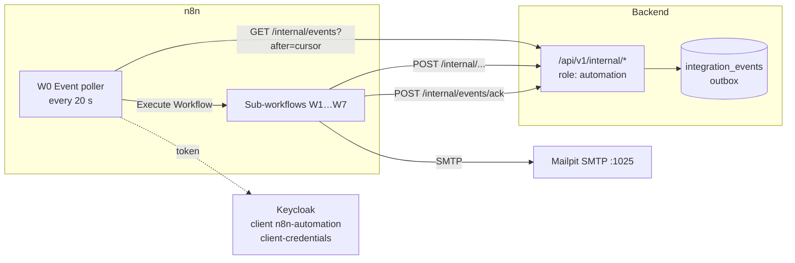
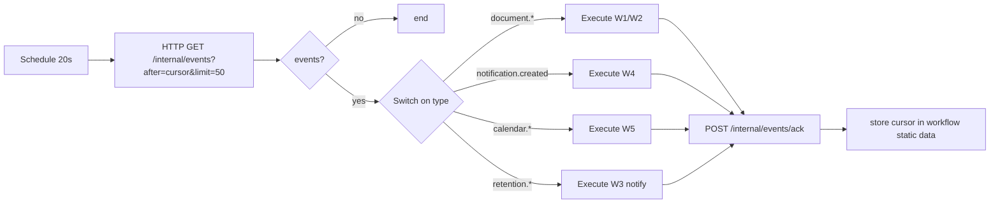
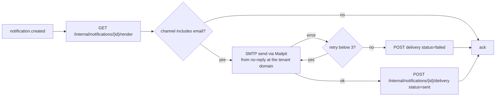

# 06 — n8n Automation Workflows

Brief §8: self-hosted n8n Community Edition handles ingestion orchestration, update/re-index workflows,
lifecycle automation, scheduled checks and notifications; FastAPI keeps parsing, chunking, embedding,
security-critical processing, permission-aware retrieval and business logic. n8n must never become a second
agent orchestrator. ADR-0019.

## 1. Boundaries

| n8n does | n8n never does |
|----------|----------------|
| Poll the backend's integration-event outbox and route events to workflows | Read or write the application database directly |
| Trigger scheduled backend operations (retention scan, calendar retries, housekeeping, re-index checks) | Parse, chunk, embed, scan or classify documents |
| Render-and-send e-mail through the backend's render endpoint and Mailpit SMTP | Decide anything about permissions, approvals, balances or risk tiers |
| Send reminders and escalations (pending reviews, failed syncs) | Call LLM providers or run agent logic |
| Provide operational visibility of automation runs | Store document or supporting-document content |

Degraded mode: if n8n is down, the backend keeps working — events accumulate in the outbox, in-app notifications
still appear, ingestion still completes (the worker owns it); only e-mails, reminders and scheduled checks are
delayed until n8n returns.

## 2. Integration mechanics

- **Authentication**: n8n holds an OAuth2 client-credentials credential for Keycloak client `n8n-automation`
  (role `automation`). Internal endpoints require that role **and** are only routed on the `internal` network
  (nginx does not expose `/internal/*` to the browser).
- **Outbox**: `integration_events(id uuid7, tenant_id, type, payload jsonb, created_at, delivered_at, attempts)`.
  Payloads contain IDs and non-sensitive facts only (never document text, never supporting-document data,
  never pseudonym mappings). The poller reads in `id` order with a cursor and acknowledges per event; handlers are
  idempotent (every event carries a unique id; e-mail sends are deduplicated by `notification_id`).
- **Error handling**: each workflow has an error branch; failures are retried by the next poll (unacknowledged
  events are redelivered up to 10 times, then marked `dead` and surfaced in the platform admin UI). n8n's global
  error workflow posts to `POST /internal/automation/errors` so failures are visible in the backend, not only in n8n.
- **Execution data hygiene**: `EXECUTIONS_DATA_SAVE_ON_SUCCESS=none`, `EXECUTIONS_DATA_SAVE_ON_ERROR=all`,
  `EXECUTIONS_DATA_PRUNE=true`, `EXECUTIONS_DATA_MAX_AGE=168` — rendered e-mails (which contain real names) are
  not retained by n8n after successful delivery.

## 3. Event catalogue (`integration_events.type`)
| Type | Emitted when | Consumed by |
|------|--------------|-------------|
| `document.uploaded` | upload stored, job enqueued | W1 (informational; starts a watchdog) |
| `document.processed` | pipeline finished: `{version_id, outcome: active\|pending_review\|quarantined\|failed, risk_score}` | W1 |
| `document.activated` / `document.superseded` | version status change | W2 (notify subscribers) |
| `notification.created` | any in-app notification is recorded | W4 |
| `retention.items_found` | retention scan produced review items | W3 → (notification is created by backend) |
| `calendar.sync_failed` | sync job exhausted retries | W5 (notification + reconciliation report) |
| `calendar.connection_expired` | refresh token invalid | W5 |
| `automation.heartbeat` | hourly by backend | W7 |

## 4. Workflows

### W0 — Event poller (Schedule trigger, every 20 s)

### W1 — Document ingestion lifecycle
- Trigger: `document.uploaded`, `document.processed` (via W0).
- Steps: on `uploaded` → set a 30-minute watchdog (`Wait` node); if no `processed` event arrives, call
  `GET /internal/documents/{version_id}/processing` and, if still running or failed, notify the uploader and
  the company administrators (`POST /internal/notifications`). On `processed` → by outcome:
  `active` → notify uploader; `pending_review` → notify reviewers for the category + schedule a 48 h reminder;
  `quarantined` → notify reviewers and company administrator with the risk summary (no content);
  `failed` → notify uploader with the reason code.
- Backend endpoints: `GET /internal/documents/{id}/processing`, `POST /internal/notifications`.

### W2 — Document updates and re-indexing
- Trigger: `document.activated`/`document.superseded` events; Schedule daily 03:00 for the index-generation check.
- Steps (event path): notify subscribers of the category (e.g., HR admins for HR docs) that a new version is live.
- Steps (scheduled path): `GET /internal/index/status` → if any tenant has `stale_generation = true` (embedding
  model or chunking rules changed) → `POST /internal/index/reindex {tenant_id}` → poll `GET /internal/index/status`
  every 5 min until complete → notify company administrators with counts. Re-indexing itself is backend jobs.

### W3 — Retention scan and HR review
- Trigger: Schedule daily 02:00; plus `retention.items_found` events.
- Steps: `POST /internal/retention/scan` (enqueues one job per tenant) → the backend creates
  `retention_review_items` and emits `retention.items_found` → W3 (event path) creates a notification for HR
  Administrators with the number of items and a link to the review screen; weekly reminder while items are pending
  (`GET /internal/retention/pending?older_than=7d`).
- n8n never deletes anything; deletion happens only after HR approval in the backend (brief §5.7).

### W4 — Notification dispatcher (e-mail)

- The render endpoint returns subject/body in the recipient's locale; it re-identifies names because e-mail is
  delivered to the authorised recipient. The e-mail body never contains leave type for calendar-style notices to
  third parties; approver notifications include the type (they need it to decide) — all decided in backend templates.

### W5 — Calendar maintenance
- Trigger: Schedule every 15 min (`POST /internal/calendar/retry-failed`) and daily 04:00
  (`POST /internal/calendar/reconcile`), plus `calendar.sync_failed` / `calendar.connection_expired` events.
- Event path: `connection_expired` → notification to the Company Administrator (shared calendar) or the employee
  (personal calendar) with a re-authorise link; `sync_failed` → notification to company administrators with the
  reconciliation link.
- The reconcile endpoint returns a summary (`missing`, `orphaned`, `mismatched` counts); W5 notifies when any > 0.

### W6 — Housekeeping (Schedule daily 01:00)
`POST /internal/maintenance/run {tasks: [checkpoint_cleanup, expired_proposals, jobs_archive, events_archive]}` →
backend enqueues jobs; W6 records the response. Pending-review reminders: `GET /internal/documents/pending-review?older_than=48h`
→ notifications to reviewers.

### W7 — Provider health digest (Schedule hourly, optional)
`GET /internal/health/providers` → if any provider `down` for > 1 h or failover count in the last hour > threshold →
notification to Platform Administrators. Purely informational.

## 5. Internal API used by n8n (summary; full contract in doc 09 §9)
| Method | Path | Purpose |
|--------|------|---------|
| GET | `/internal/events?after&limit` | Read outbox |
| POST | `/internal/events/ack` | Acknowledge `[ids]` |
| GET | `/internal/documents/{version_id}/processing` | Processing status |
| GET | `/internal/documents/pending-review?older_than` | Reviewer reminders |
| GET/POST | `/internal/index/status`, `/internal/index/reindex` | Index generations |
| POST | `/internal/retention/scan` · GET `/internal/retention/pending` | Retention |
| POST | `/internal/notifications` · GET `/internal/notifications/{id}/render` · POST `/internal/notifications/{id}/delivery` | Notifications |
| POST | `/internal/calendar/retry-failed`, `/internal/calendar/reconcile` | Calendar |
| POST | `/internal/maintenance/run` | Housekeeping |
| GET | `/internal/health/providers` | Provider health |
| POST | `/internal/automation/errors` | n8n error workflow sink |

All internal endpoints are tenant-agnostic at the HTTP level (the automation principal has no tenant); the backend
iterates tenants internally with explicit per-tenant transactions, or acts on IDs carried by the event under that
event's tenant. The automation role cannot read documents, chunks, requests, ledgers or vault data.

## 6. Workflows as code
- Exported JSON in `automation/n8n/workflows/W0-event-poller.json … W7-provider-health.json`, plus
  `automation/n8n/credentials.template.json` (no secrets).
- `n8n-init` service runs `n8n import:credentials` (from env-rendered file) and `n8n import:workflow --separate`
  on first start, then activates them (`n8n update:workflow --all --active=true`). Re-runs are idempotent (by workflow id).
- Changes are made in the n8n UI, exported with `n8n export:workflow --all --separate --output=…`, and committed.
- Tests: JSON schema validation of exports (node types, no hard-coded secrets, required settings); the backend
  internal endpoints have their own integration tests; one Compose-level end-to-end test runs W0+W4 against Mailpit
  and asserts the e-mail via Mailpit's REST API.

## 7. Security notes
- n8n UI bound to localhost only; owner account with a strong password from `.env`; `N8N_ENCRYPTION_KEY` set.
- The automation principal is restricted to `/internal/*`; any attempt to call user endpoints is denied and audited.
- Rendered e-mails are the only re-identified content n8n handles; execution data for successful runs is not stored.
- No webhook from the internet; the outbox is pull-based, so n8n needs no inbound exposure.

## 8. Licensing
n8n Community Edition under the Sustainable Use License 1.0 permits use "for your own internal business purposes".
This deployment is internal, single-organisation, not resold or hosted for third parties, and uses no `.ee.`
features. Re-verified at M8 against the current `LICENSE.md`.

## 9. M8 notes (2026-11-06) — as implemented
- **n8n 2.46.6** (`n8nio/n8n:2.46.6`, compose profile `automation`, `make up-automation`). n8n 2.x replaced
  activation with *publishing*: `n8n-init` runs `import:credentials` (rendered from
  `automation/n8n/credentials.template.json` with env values, the plain copy emptied at once),
  `import:workflow --separate` (fixed workflow ids, so re-runs overwrite) and `publish:workflow --id=…` for each
  workflow (`--all` is no longer supported; `update:workflow --active` is deprecated). The n8n service starts after
  the init job completed. The owner account is managed by the environment (`N8N_INSTANCE_OWNER_*`); its bcrypt hash
  is derived at start from `N8N_OWNER_PASSWORD`, which `make env` generates together with `N8N_ENCRYPTION_KEY`.
- **The backend creates every business notification itself**, in the business transaction (including the new
  `calendar.connection_expired` and `calendar.sync_failed`), so in-app notifications work without the optional
  profile. This amends W1, W3 and W5 above, where n8n created notifications that the backend already creates.
  n8n adds: e-mail dispatch (W4), the processing watchdog (W1, every 10 minutes), reminders (W3 weekly retention, W6 48 h
  review), the schedules (W2 03:00 index check, W3 02:00 retention scan, W5 every 15 min retry and 04:00
  reconcile, W6 01:00 housekeeping) and the provider digest (W7). The event paths of W2 (`document.activated` /
  `document.superseded`) are not emitted by the backend; W2 is the scheduled path only.
- **Outbox delivery uses a lease, not a cursor** (§2): `GET /internal/events?limit` returns the undelivered,
  unleased events of every tenant in id order and leases them for 5 minutes (`leased_until`, `attempts + 1`);
  `POST /internal/events/ack {ids}` marks them delivered; `POST /internal/events/dead {ids}` dead-letters them.
  An event offered 10 times becomes `dead` (counted in `GET /platform/health`). A lease never skips a slow
  tenant's events, which a single cursor across tenants would.
- **W0** routes `notification.created` → W4; every other type is informational (the backend has already notified);
  every branch acknowledges. Unacknowledged events (an error mid-way) come back after the lease.
- **W1 is a scheduled sweep, not a per-upload wait**: every 10 minutes `GET /internal/documents/stalled?
  older_than_minutes=30` lists versions still uploaded or processing, and W1 posts the `processing_stalled`
  reminder for each (deduplicated per version). The first design (W0 starting W1 without waiting, W1 holding a
  30-minute *Wait*) failed live on n8n 2.46.6: the fire-and-forget sub-workflow call answered "Workflow is not
  active and cannot be executed" while the waited calls to W4 worked, and every such error held back the
  acknowledgements of the whole batch. The sweep is stateless and survives n8n restarts.
- **Internal API** (§5, 18 endpoints): the table above plus `POST /internal/events/dead` and
  `GET /internal/documents/stalled`.
  `POST /internal/notifications` accepts reminder types only (`document.processing_stalled`,
  `document.review_reminder`, `retention.review_reminder`) with `{tenant_id, type, subject_id?, older_than_hours?}`;
  the backend chooses recipients and parameters and deduplicates per subject/day. `GET …/render?tenant_id` returns
  `{send, to, from_address, subject, text, html}`; `send` is false when e-mail is not a channel or the message
  was already sent. `POST …/delivery {tenant_id, status: sent|failed|skipped}` is idempotent by notification id.
  `GET /internal/health/providers` reports failovers, circuit openings and errors per provider in the last hour
  (from `provider_events`) and, when degraded, the ready-to-send alert for `PLATFORM_ALERT_EMAIL` (platform
  administrators are not employees and have no notification rows). The internal endpoints take no
  `Idempotency-Key`: leases, dedupe keys and per-id delivery states make them idempotent.
- **Network**: nginx answers `404` for `/api/v1/internal/`; n8n calls `http://api:8000` on the compose network.
- **W4 retries**: the SMTP node retries 3 times (2 s apart), then reports `failed`. W4 returns an item on **every**
  path (a no-op node when no e-mail is due): W0 acknowledges per returned item, and a path ending without output
  left 119 events re-leased live until a fix (now a unit test).
- **Run now**: every scheduled workflow also has a Manual Trigger wired to the same steps, so it can be started
  from the UI or with `n8n execute --id=…` (the CLI cannot start from a Schedule trigger).
- **Channels**: document notifications (`document.processed|failed|review_required`) and `retention.items_found`
  now go by e-mail too (they were in-app only before M8); `supporting.uploaded` stays in-app only — it concerns
  sick-leave evidence and names the file.
- **Execution data**: with `saveDataSuccessExecution: none`, n8n 2.46.6 still writes an execution row with the
  trigger's start data (the outbox event: ids only) but no node outputs; no stored execution contained a name,
  an address or a rendered e-mail (checked live). Rows are pruned after 168 h.
- **Memory**: n8n 2.46.6 ran out of its default JavaScript heap (≈ 256 MB) at start under a 512 MB limit; the
  service now has a 1 GB limit and `--max-old-space-size=768` (`N8N_MEMORY_LIMIT`, `N8N_HEAP_MB`). Measured live:
  140–560 MB (peak while starting), n8n-init 512 MB limit is enough.
- **E-mail content**: `document.failed` e-mails omit the pipeline's error text (in-app shows it to the uploader).
- **Licence re-verified 2026-11-06** (`LICENSE.md` on `master`): "Sustainable Use License, Version 1.0";
  "You may use or modify the software only for your own internal business purposes or for non-commercial or
  personal use"; files with `.ee.` in the name or `.ee` in the directory need an n8n Enterprise License. This
  deployment is internal and uses no `.ee.` feature (the environment-managed owner is in
  `instance-settings-loader`, not an `.ee` module).
