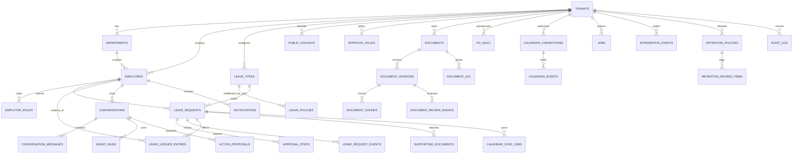
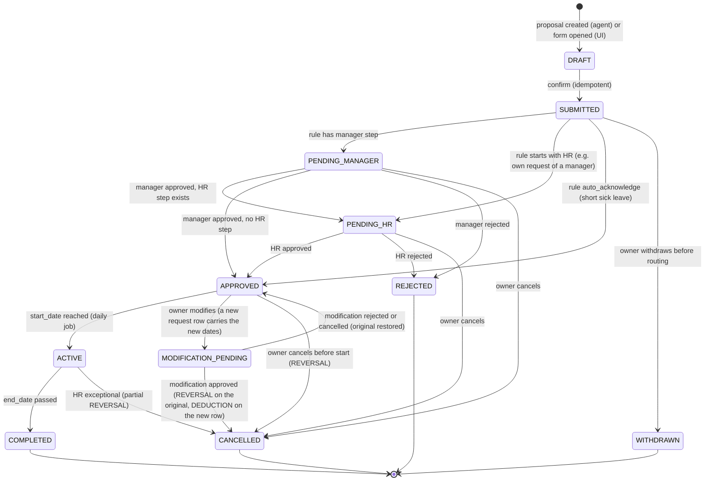

# 07 — Data Model and Database Schema

PostgreSQL 18 (`pgvector/pgvector:0.8.7-pg18`, verified 2026-11-04: PG 18.6, pgvector 0.8.7, `greek` text-search
configuration present). One instance, four databases: `leave` (application), `keycloak`, `n8n`, `langfuse`.
This document covers the `leave` database. ADRs: 0003 (RLS), 0005 (ledger), 0006 (approvals), 0008 (checkpoints).

## 1. Conventions
- Primary keys: UUIDv7 generated by the application (`IdGenerator`), type `uuid`.
- Every tenant-owned table has `tenant_id uuid NOT NULL REFERENCES platform.tenants(id)` and an RLS policy.
- Timestamps `timestamptz` in UTC; leave dates are `date` (civil dates in the tenant's timezone).
- Day quantities `numeric(6,2)`; money never exists in this system.
- `version int NOT NULL DEFAULT 1` optimistic lock on mutable aggregates (requests, documents, steps, connections).
- `created_at`, `updated_at` everywhere; `deleted_at` only on documents/supporting documents (soft delete until
  retention performs the physical delete).
- Enumerations are PostgreSQL enums created in migrations; names below are the enum labels.
- Schemas: `platform` (no RLS; platform-level objects), `app` (RLS), `langgraph` (checkpointer, own role),
  `audit` (append-only, RLS on SELECT).

## 2. Roles and row-level security

```sql
-- roles (created by deploy/postgres/init/02-roles.sql)
CREATE ROLE app_owner   LOGIN PASSWORD '…';                  -- owns all objects, runs Alembic migrations
CREATE ROLE app_rls     LOGIN PASSWORD '…' NOBYPASSRLS;      -- api + worker runtime role
CREATE ROLE langgraph_rw LOGIN PASSWORD '…' NOBYPASSRLS;     -- checkpointer only
GRANT USAGE ON SCHEMA app, platform, audit TO app_rls;
GRANT USAGE, CREATE ON SCHEMA langgraph TO langgraph_rw;     -- saver.setup() creates its tables here
-- per table (generated by a migration helper for every table in app/audit that has tenant_id):
ALTER TABLE app.leave_requests ENABLE ROW LEVEL SECURITY;
ALTER TABLE app.leave_requests FORCE  ROW LEVEL SECURITY;    -- applies to the owner too
CREATE POLICY tenant_isolation ON app.leave_requests
  USING      (tenant_id = NULLIF(current_setting('app.tenant_id', true), '')::uuid)
  WITH CHECK (tenant_id = NULLIF(current_setting('app.tenant_id', true), '')::uuid);
GRANT SELECT, INSERT, UPDATE, DELETE ON app.leave_requests TO app_rls;   -- audit tables: INSERT, SELECT only
```

- The runtime sets the context per transaction: `SET LOCAL app.tenant_id = :tenant; SET LOCAL app.user_id = :user;
  SET LOCAL app.roles = :roles` in SQLAlchemy's `after_begin` event (from the request contextvar). `SET LOCAL`
  dies with the transaction, so a pooled connection never carries a previous request's tenant.
- **Verified gotcha (pg18 smoke test):** after any `SET LOCAL` in a session, `current_setting('app.tenant_id', true)`
  returns `''` rather than `NULL` once the transaction ends; a naive `::uuid` cast then *errors*. The `NULLIF(…, '')`
  form yields `NULL`, the policy evaluates to false, and queries without context return **zero rows** (fail closed).
  The isolation test suite asserts exactly this behaviour under concurrent requests.
- Platform operations (tenant creation, platform settings) touch `platform.*` tables, which have no tenant RLS but
  are protected by application policy (`platform_admin` only). Seeding a new tenant's defaults runs in one
  provisioning transaction that sets `app.tenant_id` to the new tenant explicitly.
- `langgraph_rw` has no privileges on `app`, `platform` or `audit`; `app_rls` has none on `langgraph`.
- A meta-test queries `pg_policies`/`pg_class` to assert that **every** table with a `tenant_id` column has
  `relrowsecurity = relforcerowsecurity = true` and a `tenant_isolation` policy.

## 3. Entity overview



## 4. Table catalogue

Column lists show the essential columns; all tables also have `id`, `created_at`, `updated_at` unless noted, and
tenant tables have `tenant_id` (+ RLS). `→` marks a foreign key.

### 4.1 Platform schema (`platform`, no tenant RLS)
| Table | Columns | Notes |
|-------|---------|-------|
| `tenants` | `slug unique`, `name`, `status (active\|suspended)`, `default_locale (el\|en)`, `timezone`, `settings jsonb` (work week, upload limits, conversation retention days, proposal ttl, `allow_hr_fallback`), `keycloak_group_id` | Created by platform admins; `settings` validated by a Pydantic schema |
| `platform_settings` | `key unique`, `value jsonb`, `updated_by` | Provider policy defaults, global limits |
| `security_policy_defaults` | `risk_low_max`, `risk_medium_max`, `injection_llm_judge bool`, `max_upload_mb`, … | Copied into `app.security_policies` at tenant creation; platform admin can update defaults only |

### 4.2 Tenancy and organisation (`app`)
| Table | Columns | Notes |
|-------|---------|-------|
| `departments` | `name`, `code`, `manager_employee_id → employees (nullable, deferred FK)`, `parent_id?` (P3) | unique `(tenant_id, code)` |
| `employees` | `keycloak_sub unique`, `employee_number`, `first_name`, `last_name`, `email`, `department_id →`, `manager_override_employee_id →?`, `hire_date`, `locale`, `status (active\|inactive)` | Names/e-mails are real here (vault pseudonymises on the way to the LLM) |
| `employee_roles` | `employee_id →`, `role (employee\|manager\|hr_admin\|company_admin)` | Mirror of Keycloak roles for routing/notification queries; token roles remain the authorization truth; reconciled by housekeeping |

### 4.3 Leave domain (`app`)
| Table | Columns | Notes |
|-------|---------|-------|
| `leave_types` | `code (annual\|sick\|unpaid)`, `name_el`, `name_en`, `balance_bearing bool`, `allow_retroactive_days int`, `requires_document_above_days int?`, `active bool` | unique `(tenant_id, code)` |
| `leave_policies` | `leave_type_id →`, `year int`, `entitlement_days numeric`, `carryover_max_days numeric`, `carryover_expires_on date?`, `allow_negative bool`, `min_notice_days int`, `max_consecutive_days int?`, `prorate_on_hire bool`, `grant_mode (upfront\|monthly_accrual; seed upfront)` | unique `(tenant_id, leave_type_id, year)`; seed values per doc 01 §6 |
| `public_holidays` | `holiday_date date`, `name_el`, `name_en`, `recurring bool` | unique `(tenant_id, holiday_date)`; work week in `tenants.settings.work_week` |
| `approval_rules` | `leave_type_id →?` (null = any), `min_working_days numeric`, `max_working_days numeric?`, `requires_document bool`, `steps text[]` (ordered: `manager`, `hr`), `auto_acknowledge bool`, `priority int`, `active bool` | First matching rule by priority wins (domain engine) |
| `leave_requests` | `request_number (per-tenant sequence)`, `employee_id →`, `leave_type_id →`, `start_date`, `end_date`, `working_days numeric`, `status`, `reason text?`, `submitted_at`, `decided_at?`, `cancelled_at?`, `modification_of_request_id →?`, `idempotency_key`, `version` | `status` enum: `DRAFT, SUBMITTED, PENDING_MANAGER, PENDING_HR, APPROVED, ACTIVE, COMPLETED, REJECTED, CANCELLED, WITHDRAWN, MODIFICATION_PENDING`; exclusion constraint prevents overlapping non-cancelled requests per employee (`daterange` + GiST) |
| `leave_request_events` | `request_id →`, `event_type`, `from_status`, `to_status`, `actor_employee_id →?`, `actor_kind (employee\|manager\|hr\|system\|agent)`, `payload jsonb`, `occurred_at` | Immutable history (INSERT only) |
| `approval_steps` | `request_id →`, `step_no`, `approver_role (manager\|hr)`, `designated_employee_id →?`, `status (pending\|approved\|rejected\|skipped\|cancelled)`, `decided_by_employee_id →?`, `decided_at`, `comment`, `via (ui\|agent)`, `fallback bool`, `version` | unique `(request_id, step_no)`; `fallback` marks an HR decision on a manager step |
| `leave_ledger_entries` | `employee_id →`, `leave_type_id →`, `period_year int`, `entry_type (GRANT\|DEDUCTION\|REVERSAL\|ADJUSTMENT\|CARRYOVER\|EXPIRY)`, `quantity_days numeric (signed)`, `effective_date`, `request_id →?`, `reason`, `created_by_employee_id →?`, `idempotency_key unique` | INSERT only; no UPDATE/DELETE grants to `app_rls` |
| `leave_balances` (VIEW) | `employee_id, leave_type_id, period_year, balance_days = SUM(quantity_days)`, `pending_days = SUM(working_days of requests in PENDING_* / MODIFICATION_PENDING)`, `available_days = balance − pending` | Derived; never stored |
| `action_proposals` | `conversation_id →`, `employee_id →`, `kind (submit\|modify\|cancel\|approve\|reject)`, `payload jsonb` (validated request/decision), `payload_hash`, `status (pending\|confirmed\|rejected\|expired\|executed\|failed)`, `expires_at`, `executed_request_id →?`, `outcome jsonb` | `id` doubles as the idempotency key for execution |

### 4.4 Documents and retrieval (`app`)
| Table | Columns | Notes |
|-------|---------|-------|
| `documents` | `title`, `category (policy_general\|policy_hr_restricted\|department_notice\|admin_internal)`, `department_id →?`, `owner_employee_id →`, `active_version_id →?`, `language_hint`, `deleted_at?`, `version` | |
| `document_versions` | `document_id →`, `version_no`, `object_key`, `original_filename`, `mime`, `size_bytes`, `sha256`, `status` (doc 05 §2), `pages int?`, `language`, `extracted_object_key?` (normalised block tree as JSON in object storage; M4 replaces `parsed_structure jsonb`), `risk_score`, `risk_tier (low\|medium\|high)`, `risk_findings jsonb`, `pii_summary jsonb`, `processing_error`, `processed_at`, `index_generation`, `retrievable bool`, `uploaded_by_employee_id →`, `attempts` | `retrievable = (status = ACTIVE)` maintained by the service |
| `document_chunks` | `version_id →`, `ordinal`, `chunk_type (text\|table)`, `heading_path text[]`, `page_start`, `page_end`, `language`, `content text`, `content_llm_safe text`, `token_count`, `embedding vector(384)`, `embedding_model_id`, `tsv_el tsvector GENERATED`, `tsv_en tsvector GENERATED`, `tsv_simple tsvector GENERATED`, `risk_flags text[]`, `has_pii bool`, `retrievable bool` | Indexes: HNSW on `embedding` (cosine, partial `WHERE retrievable`), GIN on the three tsv columns, btree `(tenant_id, version_id, ordinal)`. `tsv_simple` is generated over `app.f_unaccent(content)` (IMMUTABLE wrapper of `unaccent`, M4) |
| `document_acl` | `document_id →`, `principal_type (role\|department\|employee)`, `principal_id`, `permission (read)` | HR-restricted cannot be opened to employees (policy check) |
| `document_review_events` | `version_id →`, `reviewer_employee_id →`, `action (release\|reject\|delete\|inspect)`, `comment`, `occurred_at` | |
| `index_generations` | `generation text`, `embedding_model_id`, `chunking_rules_version`, `status (building\|active\|retired)`, `started_at`, `completed_at` | One active per tenant |
| `supporting_documents` | `request_id →`, `employee_id →`, `object_key`, `original_filename`, `mime`, `size_bytes`, `sha256`, `encrypted_dek bytea`, `status (stored\|retention_pending\|deleted)`, `retention_until date?`, `deleted_at?` | Never parsed/indexed; see doc 08 §9 |
| `supporting_document_access_events` | `supporting_document_id →`, `actor_employee_id →`, `action (view\|download_token\|download\|delete)`, `occurred_at`, `reason?`, `request_id (http)` | INSERT only; mirrored to `audit.audit_log`; `download_token` added in M5 (the token issue is itself an access) |
| `supporting_download_tokens` (**`platform` schema, M5**) | `token_hash (sha256, pk)`, `tenant_id →`, `supporting_document_id`, `actor_employee_id`, `actor_user_id`, `actor_roles text[]`, `expires_at`, `created_at`, `reason?`, `used_at?` | Presented without a bearer, so it lives outside RLS like `platform.jobs`; consumed atomically; rows older than a day are swept on use |

### 4.5 Privacy and security (`app`)
| Table | Columns | Notes |
|-------|---------|-------|
| `pii_vault` | `entity_type (PERSON\|EMAIL\|PHONE\|AMKA\|AFM\|ID_CARD\|IBAN\|ADDRESS\|DATE_OF_BIRTH\|OTHER)`, `value_hmac bytea unique per tenant`, `value_encrypted bytea`, `placeholder text unique per tenant` (e.g. `PERSON_0042`), `first_seen_at`, `last_seen_at`, `source_kinds text[]` | HMAC key and KEK from environment; counters per `(tenant_id, entity_type)` via `pii_vault_counters` |
| `pii_vault_counters` | `entity_type`, `next_seq int` | |
| `security_policies` | `risk_low_max numeric`, `risk_medium_max numeric`, `injection_llm_judge bool`, `user_input_block_threshold numeric`, `max_upload_mb int`, `allowed_mime text[]`, `updated_by` | One row per tenant (`tenant_id` is the primary key); created at provisioning and back-filled by migration `0004`/the seed from `platform.security_policy_defaults` (single row `id = 1`: the defaults plus `threshold_min`, `threshold_max`, `max_upload_mb_limit` — the ranges tenants may configure within) |
| `injection_findings` | `subject_type (document_version\|user_message)`, `subject_id`, `detector (heuristic\|classifier\|structural\|llm_judge)`, `score`, `label`, `excerpt_hash`, `details jsonb` | Excerpts are hashed, not stored (reviewers see pseudonymised excerpts on `document_versions.risk_findings`) |
| `idempotency_keys` (**`platform` schema since M1**) | `tenant_id?` (informational), `user_id`, `route`, `key`, `request_hash`, `response_status`, `response_body jsonb`, `expires_at` | unique `(user_id, route, key)`; TTL 24 h. Lives in `platform` without RLS because platform administrators have no tenant; rows are private to the Keycloak `sub` and every query filters on it (M1 decision, worklog M1) |

M5 note (migration `0004_security_privacy`): the M5 tables use `text` columns instead of PostgreSQL enums for
`entity_type`, statuses, `document_class`, `action` and `detector` (values are owned by the domain enums, no `ALTER TYPE`
for additions); statuses and retention days also carry CHECK constraints; `pii_vault_counters.next_seq` is advanced with an atomic
`INSERT … ON CONFLICT DO UPDATE … RETURNING`; `retention_review_items` has a partial unique index on
`(tenant_id, subject_type, subject_id) WHERE status = 'pending'`.

### 4.6 Conversations and agent (`app`)
| Table | Columns | Notes |
|-------|---------|-------|
| `conversations` | `employee_id →`, `title`, `status (open\|archived)`, `last_activity_at`, `locale` | `id` = LangGraph `thread_id` |
| `conversation_messages` | `conversation_id →`, `role (user\|assistant\|system_note)`, `content_pseudonymised text`, `citations jsonb?`, `interrupt_card jsonb?`, `run_id →?`, `created_at` | Display history; re-identified at read time for the owner |
| `agent_runs` | `conversation_id →`, `turn int`, `intent`, `language`, `route`, `provider_used`, `model_used`, `failovers int`, `input_tokens`, `output_tokens`, `latency_ms`, `tool_trace jsonb`, `outcome (answered\|insufficient_evidence\|interrupted\|executed\|blocked\|error)`, `langfuse_trace_id` | Evaluation and history; no prompt bodies |
| `pending_interrupts` | `conversation_id →`, `proposal_id →`, `expires_at` | Mirror of the graph interrupt for UI and cleanup — **M7** (needs `action_proposals`) |
| `provider_events` | `provider`, `model`, `event (selected\|failover\|circuit_open\|circuit_close\|error)`, `reason`, `latency_ms`, `occurred_at` | Tenant-scoped; aggregated for health endpoints |

M6 note (migration `0005_conversations`): `conversations` also stores `user_id` (the Keycloak sub) and
`run_lock_until` (one run per conversation; a crashed run's lock expires); `conversation_messages` gains
`provenance jsonb` (placeholder → `{kind, id}`) because re-identification at read time needs the source of every
placeholder, and `outcome`; `agent_runs` gains `details jsonb` (retrieval scores, input-risk score, stages, error);
`provider_events` carries `run_id`. Schema `langgraph` is created by the migration (owner `app_owner`, `USAGE,
CREATE` for `langgraph_rw`); the saver's `setup()` runs in `make migrate` as `langgraph_rw`.

M7 note (migration `0006_agent_operations`): `action_proposals` also stores `created_at`, `run_id` (the run that
prepared it), `claimed_by_run` and `claimed_at` (the run that claimed it for execution) and `decided_at`; `status`
`confirmed` means *claimed for execution* (exactly one winner of the atomic `UPDATE … WHERE status = 'pending' AND
expires_at > now() RETURNING`). Text columns with CHECK constraints for `kind` and `status`, forced RLS.
`pending_interrupts` is keyed by `conversation_id` (one open interrupt per conversation). `conversation_messages`
gains `proposal_id` (the card a message carries, rendered at read time with the proposal's current status). Two
exactly-once guards: a partial unique index on `leave_requests (tenant_id, employee_id, idempotency_key)` (submit
returns the existing request for a known key; agent executions use `proposal:{id}`), and an expression index on
`leave_request_events (tenant_id, payload->>'proposal_id')` for stale-claim recovery. Request events and audit
entries written by an agent execution carry `{"via": "agent", "proposal_id": …}`; the actor stays the human.

### 4.7 Integrations, jobs, notifications, retention (`app`)
| Table | Columns | Notes |
|-------|---------|-------|
| `calendar_connections` | `kind (company_shared\|personal)`, `employee_id →?`, `provider (google\|mock)`, `external_calendar_id`, `refresh_token_encrypted bytea`, `scopes text[]`, `status (active\|expired\|revoked)`, `authorised_by_employee_id →`, `last_success_at`, `last_error`, `version` | One `company_shared` per tenant |
| `calendar_sync_jobs` | `request_id →`, `connection_id →`, `operation (create\|update\|delete)`, `status (pending\|running\|succeeded\|failed\|dead)`, `attempts`, `next_attempt_at`, `last_error_class`, `last_error`, `idempotency_key unique` | Outbox for calendar side effects; doc 10 |
| `calendar_events` | `request_id →`, `connection_id →`, `external_event_id`, `payload_hash`, `status (present\|deleted\|orphaned\|missing)`, `last_verified_at` | Mapping + reconciliation state |
| `notifications` | `recipient_employee_id →`, `type`, `params jsonb`, `channels text[] (in_app, email)`, `read_at?`, `email_status (pending\|sent\|failed\|skipped)`, `email_attempts`, `dedupe_key unique?` | Rendered per locale at read/dispatch time |
| `integration_events` | `type`, `payload jsonb`, `delivered_at?`, `attempts`, `dead bool` | Outbox polled by n8n; IDs only in payloads |
| `jobs` (**`platform` schema since M4**) | `tenant_id?`, `type`, `payload jsonb`, `status (queued\|running\|succeeded\|failed\|dead)`, `attempts`, `max_attempts`, `run_after`, `locked_by`, `locked_at`, `heartbeat_at`, `last_error`, `dedupe_key` (unique while queued/running), `finished_at`, `extra jsonb` | `FOR UPDATE SKIP LOCKED` queue claimed across tenants (no RLS, like `platform.idempotency_keys`; payloads carry identifiers only); the handler then opens a tenant-scoped transaction (`SET LOCAL app.tenant_id` from the row). `failed` = attempts exhausted (dead letter, retryable by an administrator); `dead` reserved |
| `retention_policies` | `document_class (supporting_document\|company_document\|conversation\|leave_record)`, `retention_days int`, `action (notify_only\|delete_after_review)`, `enabled bool`, `updated_by` | No legal defaults assumed; seed values are placeholders marked as such |
| `retention_review_items` | `policy_id →`, `subject_type`, `subject_id`, `eligible_since`, `status (pending\|approved_delete\|retained\|deleted)`, `reviewer_employee_id →?`, `decided_at`, `comment` | Deletion executes as a job after approval |

### 4.8 Audit (`audit`, INSERT + SELECT only for `app_rls`)
| Table | Columns | Notes |
|-------|---------|-------|
| `audit_log` | `tenant_id?` (null for platform events), `occurred_at`, `actor_kind (user\|automation\|system\|agent)`, `actor_id`, `actor_roles text[]`, `action` (taxonomy in doc 08 §10), `resource_type`, `resource_id`, `outcome (success\|denied\|error)`, `request_id`, `thread_id?`, `details jsonb` (no PII beyond IDs), `prev_hash bytea?`, `hash bytea?` | Hash chain per tenant (P3). Monthly partitioning deferred (M1: plain table with `(tenant_id, occurred_at)` index — no partition tooling in the image, tiny volume). Policies: `tenant_isolation` (SELECT, tenant rows), `platform_read` (SELECT, NULL-tenant rows for `app.platform_admin = 'true'`), `audit_insert` (tenant contexts write their tenant; tenant-less contexts write NULL-tenant rows); no UPDATE/DELETE grants |

### 4.9 LangGraph schema (`langgraph`, role `langgraph_rw`)
Tables are created by `AsyncPostgresSaver.setup()` (`checkpoints`, `checkpoint_blobs`, `checkpoint_writes`,
`checkpoint_migrations`). They are keyed by `thread_id` only; tenant ownership is enforced by `app.conversations`
before any access. A nightly job deletes rows for conversations past retention or deleted.

## 5. State machines

### 5.1 Leave request

Transitions are implemented in `domain/leave/state_machine.py` as a table `(from, event, guard) → to`; the
service applies them under `SELECT … FOR UPDATE` and the `version` check, writes `leave_request_events`, and
performs ledger postings in the same transaction.

**M2 implementation notes (2026-11-05):** a modification of an approved request is a *new* request row
(`modification_of_request_id` → original) that runs the normal approval chain while the original waits in
`MODIFICATION_PENDING`; the exclusion constraint therefore ignores `MODIFICATION_PENDING` rows. Modifications of
pending requests edit the same row (steps cancelled and re-materialised). Request numbers come from
`app.request_counters(tenant_id, year, next_seq)` locked per tenant/year; ledger postings lock the employee row.
`APPROVED → ACTIVE → COMPLETED` and the ledger calendar (grants, carry-over, expiry) run as a periodic task of the
worker loop (every 15 minutes, per tenant in its timezone) and via `make rollover`; the generic `jobs` queue arrives
in M4. `app.leave_balances` is a `security_invoker` view (RLS of the caller); `pending_days` counts
`SUBMITTED/PENDING_*` requests in their start year. Supporting-document flags are advisory until M4 (uploads).

### 5.2 Ledger rules
| Event | Entries |
|-------|---------|
| Policy year start / hire | `GRANT +entitlement` (pro-rated if configured), `CARRYOVER +min(prev balance, cap)` |
| Carry-over expiry date | `EXPIRY −unused carry-over` |
| Final approval | `DEDUCTION −working_days` (balance-bearing types only) |
| Cancellation after approval | `REVERSAL +working_days` (or unused part) |
| Modification approved | `REVERSAL +old`, `DEDUCTION −new` (same transaction) |
| HR adjustment | `ADJUSTMENT ±n` with reason, audited |

Balance checks read `leave_balances.available_days` for the request's `period_year` (a request spanning years is
split into two deductions, one per period; the UI shows both).

## 6. Working days
`WorkingDayService.count(tenant, start, end)` = days in `[start, end]` not in the tenant's weekend set
(`tenants.settings.work_week`, default Mon–Fri) and not in `public_holidays` for that tenant. Pure Python domain
function with property-based tests; holidays are loaded per request (small table).

## 7. Retention per table
| Data | Default | Mechanism |
|------|---------|-----------|
| Conversations, messages, checkpoints, agent runs | 90 days after last activity (tenant setting); automatic, no review (decided Q-08/Q-14) | `checkpoint.cleanup` job |
| Idempotency keys | 24 h | housekeeping |
| Integration events / jobs | 30 days after completion | housekeeping (archive table) |
| Supporting documents | seed placeholder: 365 days after the leave end date, `delete_after_review` → HR review (decided Q-08; not legal advice) | `retention.scan` job (daily in the worker loop, `make retention-scan`) → `retention_review_items` → HR decision → `retention.delete` job (object removed, tombstone kept) |
| Company documents (superseded/retired) | seed placeholder: 730 days after the version was superseded/retired, `delete_after_review` → HR decides (decided Q-08) | same workflow; the version becomes `DELETED`, its chunks and objects are removed |
| Audit log | never deleted by the application (export tooling only) | — |
| Leave records, ledger | never deleted (business records) | — |

## 8. Migrations and seed
- Alembic migrations in `backend/alembic/versions`; the first migration creates schemas, enums, tables, RLS policies
  (via a helper that applies the standard policy to every tenant table) and grants. `saver.setup()` for LangGraph
  runs from a migration step executed as `langgraph_rw`.
- Seed (`python -m leave_assistant.seed`, idempotent, M1): runs through the provisioning and administration services as
  synthetic principals (`seed`, audited as `system`), so Keycloak users, groups and rows follow the production path. Two tenants, departments, employees (also created in Keycloak via the Admin
  API with dev passwords), roles, leave types/policies for the current year, holidays (Greek public holidays 2026 for
  Aegean Logistics; Irish public holidays 2026 for Brightwater Software — decided Q-07), approval rules, security
  policies from defaults, retention placeholders, seed documents (doc 05 §10) enqueued for processing.
