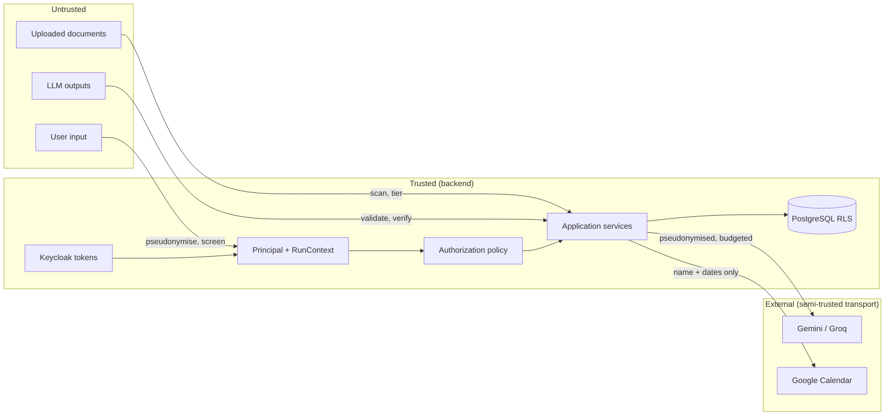
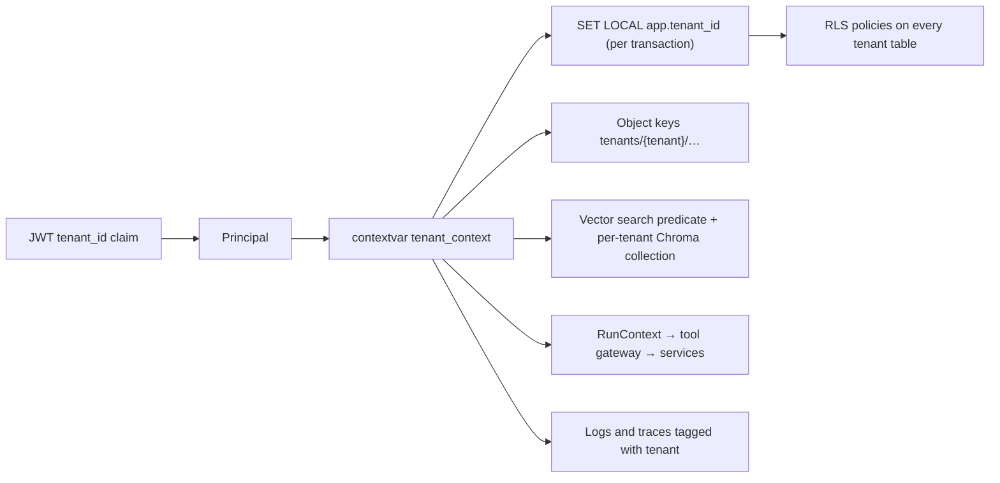
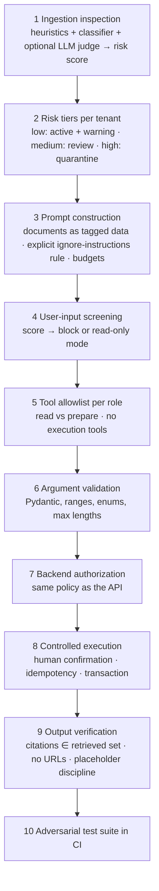

# 08 — Security Architecture

Covers brief deliverables 12 (multi-tenant security design), 13 (authentication and authorization) and 15
(PII and prompt-injection threat model), plus supporting-document protection (§5.6), risk-based document
handling (§9.5) and audit. ADRs: 0003, 0004, 0009, 0016, 0017, 0018, 0027.

## 1. Security objectives and assets

| Asset | Protection goal | Primary controls |
|-------|-----------------|------------------|
| Tenant business data (requests, balances, employees) | confidentiality, integrity, isolation | Keycloak identity, application policy, RLS, audit |
| Company documents (incl. HR-restricted) | confidentiality by role, integrity of what the assistant cites | category visibility, ACL, RLS, citation verification, quarantine |
| Sick-leave supporting documents | strict confidentiality; no processing | separate storage path, envelope encryption, HR-only, audited access, excluded from LLM/Langfuse by type |
| Personal data in prompts | minimisation outside the host | pseudonymisation vault, re-identification policy, masking |
| Business operations (submit/approve/cancel) | authorization, idempotency, non-repudiation | tool gateway, confirmation interrupts, service-level checks, audit |
| Credentials and keys (provider keys, OAuth refresh tokens, KEK) | secrecy | env/Docker secrets, encryption at rest, no logging |
| Agent behaviour | resistance to injection and misuse | layered injection defence, allowlists, strict argument validation, output verification |

## 2. Trust boundaries

## 3. Threat model

### 3.1 STRIDE summary
| Threat | Example | Mitigation |
|--------|---------|------------|
| Spoofing | forged/expired JWT; service account misuse | JWKS signature + `iss`/`aud`/`exp`/`alg` checks; short-lived access tokens (5 min) with refresh; client-credentials limited to `/internal/*`; audit of denials |
| Tampering | request body manipulation to another employee's ID; proposal payload edits | server-side resource ownership checks; proposals stored server-side with content hash; optimistic locking |
| Repudiation | "I never approved that" | append-only audit log with actor, via (ui/agent), request id, thread id; approval steps record decider |
| Information disclosure | cross-tenant reads; manager reading HR docs; PII to providers; supporting documents in traces | RLS + policy; category visibility; vault; type-level exclusion; Langfuse masking; log scrubbing |
| Denial of service | upload bombs; prompt floods; provider quota exhaustion | size/page limits; per-user rate limits; token budgets; circuit breakers; job timeouts |
| Elevation of privilege | LLM "decides" the user is HR; tool with elevated scope | roles only from JWT; allowlist per role; tools call the same policy as the API; no execution tools exposed to the model |

### 3.2 OWASP Top 10 for LLM applications — mapping
| Risk | Relevance | Controls |
|------|-----------|----------|
| LLM01 Prompt injection | documents and user messages | §8: ingestion scanning, risk tiers, quarantine, hardened prompts, allowlists, confirmation, output verification, adversarial tests |
| LLM02 Sensitive information disclosure | PII in prompts/answers | §7: pseudonymisation, authorised re-identification, exclusions |
| LLM03 Supply chain | models and packages | pinned lockfile, model revisions pinned, licence review, `pip-audit`/`npm audit` in CI |
| LLM04 Data and model poisoning | poisoned documents | review/quarantine workflow, provenance (uploader, version, checksum), citations |
| LLM05 Improper output handling | answers with invented citations/HTML | structured outputs, citation verification, Markdown rendering with sanitisation, no HTML execution |
| LLM06 Excessive agency | tools that execute | propose→confirm→execute, read-only tools by default, no execution tools for the model |
| LLM07 System prompt leakage | prompt contains no secrets | prompts contain no credentials, mappings or other tenants' data; leakage is harmless by construction |
| LLM08 Vector/embedding weaknesses | cross-tenant retrieval | tenant + permission predicates in SQL, RLS, per-tenant Chroma collections (eval only) |
| LLM09 Misinformation | hallucinated policy | strict grounding, evidence threshold, "I don't know" path, citations |
| LLM10 Unbounded consumption | quota and cost | budgets, iteration caps, rate limits, circuit breakers |

## 4. Identity: Keycloak design (ADR-0004)

- **Realm** `leave-assistant` (single realm). Clients:
  - `frontend-spa` — public client, Authorization Code + PKCE, redirect URIs for `http://localhost:8080/*`,
    access token lifespan 5 min, SSO session idle 30 min, max 10 h; `web-origins` restricted.
  - `backend-api` — bearer-only audience; the SPA requests `aud=backend-api` via an audience mapper.
  - `n8n-automation` — confidential, service account, role `automation`.
  - `backend-admin` — confidential, service account with realm-management roles (`manage-users`, `query-groups`)
    used only by the provisioning service.
- **Roles** (realm roles): `employee`, `manager`, `hr_admin`, `company_admin`, `platform_admin`, `automation`.
- **Tenant membership**: group `/tenants/<slug>` with group attribute `tenant_id`; a protocol mapper emits the
  claim `tenant_id` (single value). Platform administrators are in `/platform` and carry no `tenant_id`.
  Users belong to exactly one tenant group (enforced by provisioning; the backend rejects tokens with multiple
  tenant claims).
- **Token claims used**: `sub`, `tenant_id`, `realm_access.roles`, `aud`, `exp`, `iat`, `azp`, `preferred_username`,
  `locale`. Nothing else is trusted from the token; the employee record is looked up by `sub` under the tenant.
- **Validation**: `PyJWKClient` with cached keys (TTL 10 min, forced refresh on unknown `kid`), algorithm allowlist
  `RS256`/`ES256`, `aud` must contain `backend-api`, clock skew 30 s.
- **Provisioning**: creating an employee in the admin UI creates the Keycloak user (temporary password or
  invitation), assigns roles, adds to the tenant group, and stores `keycloak_sub`; disabling an employee disables
  the user. The realm export in `deploy/keycloak/realm-export.json` seeds dev users for both companies.
- **Dev security posture**: HTTP on localhost only; Keycloak admin console bound to localhost; dev passwords in
  `.env.example` clearly marked; production notes documented but out of scope.

## 5. Authorization policy

### 5.1 Principal
`Principal(user_id, tenant_id | None, employee_id | None, department_id | None, roles, is_platform_admin, is_automation)`
is built per request; services receive it explicitly (no globals except the DB context).

### 5.2 Permission matrix (actions × roles; scope in parentheses)
| Action | Employee | Manager | HR Admin | Company Admin | Platform Admin |
|--------|----------|---------|----------|---------------|----------------|
| Read own balance/requests/history | ✓ (self) | ✓ (self) | ✓ (self) | ✓ (self) | — |
| Submit/modify/cancel own request | ✓ | ✓ | ✓ | ✓ | — |
| Read department requests/availability | — | ✓ (own dept) | ✓ (tenant) | ✓ (tenant, read) | — |
| See leave type of team requests | — | ✓ (own dept; sick leave as type only) | ✓ | absence only | — |
| Read sick-leave reason text, supporting documents, HR review details | own | — | ✓ | — | — |
| Decide manager step | — | ✓ (own dept, not own request) | ✓ (fallback, audited; decided Q-03) | — | — |
| Decide HR step | — | — | ✓ | — | — |
| Read `policy_general` documents | ✓ | ✓ | ✓ | ✓ | — |
| Read `policy_hr_restricted` | — | — | ✓ | ✓ | — |
| Upload/manage documents | — | dept notices (P3) | HR categories + general | general + admin_internal | — |
| Review medium/high-risk documents | — | — | HR categories | general categories | — |
| View supporting documents | own | — | ✓ (tenant), audited | — | — |
| Retention review/delete | — | — | ✓ | — | — |
| Manage employees/departments/holidays/rules/policies | — | — | — | ✓ | — |
| Authorise company calendar; connect personal calendar | personal | personal | personal | company + personal | — |
| Security thresholds (tenant) | — | — | — | ✓ | defaults only |
| Create/manage tenants, platform settings | — | — | — | — | ✓ |
| Read tenant business data or documents | — | — | — | — | **never** |
| Chat with the assistant | ✓ | ✓ | ✓ | ✓ | — (no tenant context) |

- Implemented as `authorize(principal, action, resource) -> Decision` in `application/authz`; the same function
  backs REST endpoints and the tool gateway; deny-by-default; every denial is audited with `outcome=denied`.
- Scopes: `self` (employee_id match), `department` (resource.department_id == principal.department_id and
  principal is that department's manager), `tenant`, `platform`.
- Role combinations: a user who is both `manager` and `hr_admin` cannot decide both steps of the same request
  (segregation of duties check); nobody can decide a step on their own request.

## 6. Multi-tenant isolation (ADR-0003)

1. **Identity layer**: tenant comes only from the token's `tenant_id` claim (set by Keycloak group mapping).
2. **Application layer**: every repository method takes the tenant from the context; services assert that loaded
   resources belong to the principal's tenant (belt) even though RLS makes other tenants' rows invisible (braces).
3. **Database layer**: RLS with transaction-scoped settings and a `NOBYPASSRLS` runtime role; `FORCE` so the
   owner is bound too; verified `NULLIF` policy pattern (doc 07 §2); meta-test ensures no tenant table lacks a policy.
4. **Storage layer**: S3 keys are prefixed by tenant; the storage port signs nothing for browsers — the API streams
   objects after authorization; bucket listing is never exposed.
5. **Retrieval layer**: SQL predicates (tenant, status, visibility) inside the same transaction; Chroma (eval only)
   isolates by collection name derived from the tenant and by version-id filters computed in PostgreSQL.
6. **Agent layer**: `RunContext` is immutable and model-invisible; thread ownership is checked before resuming.
7. **Jobs/automation**: jobs carry `tenant_id` and run under that context; the automation principal has no tenant
   and can only reach `/internal/*`, which never returns tenant content.
8. **Platform admins** have no tenant context; RLS returns nothing for tenant tables; provisioning uses an
   explicit, audited context switch.
9. **Tests**: cross-tenant attempts through API, tools, retrieval, storage keys and thread IDs; concurrency leak
   test with interleaved requests from two tenants on a small pool.

## 7. PII protection (brief §9.1–§9.3, ADR-0017)

### 7.1 Detection
- Presidio Analyzer with a spaCy NLP engine configured for `en` (`en_core_web_lg`) and `el` (`el_core_news_md`);
  language chosen per text by `lingua`. Built-in recognisers: PERSON (NER), EMAIL_ADDRESS, PHONE_NUMBER (region `GR`
  and international), IBAN_CODE, DATE_TIME (used only to detect dates of birth in context), LOCATION, URL.
- **Custom Greek recognisers** (pattern + checksum + context words in Greek and English):
  `GR_AMKA` (11 digits, first 6 a valid DDMMYY date, Luhn-like check), `GR_AFM` (9 digits with the AFM checksum),
  `GR_ID_CARD` (1–2 Greek capital letters + 6 digits), `GR_PHONE` (mobile `69xxxxxxxx`, landline `2xxxxxxxxx`),
  Greek PERSON context boosters (`κ.`, `κα`, `ο/η εργαζόμενος/η`).
- Presidio is not perfect (brief §9.3): detection thresholds are conservative (score ≥ 0.4 → pseudonymise), and
  for **known entities** (all employee names and e-mails in the tenant) a deterministic dictionary recogniser
  guarantees replacement regardless of NER confidence — the known-entity list is the strongest layer.

### 7.2 Pseudonymisation vault
- Placeholder format `{ENTITY_TYPE}_{seq:04d}` (e.g. `PERSON_0042`, `EMAIL_0007`), **stable per tenant**: the same
  value always maps to the same placeholder across messages, documents and tool results, so the model can reason
  consistently ("PERSON_0042's request") without ever seeing a name.
- Lookup key = HMAC-SHA256(tenant-scoped key, normalised value); original value stored encrypted (AES-256-GCM with
  the vault KEK). The mapping table is in the `leave` database under RLS; the LLM, Langfuse, logs and n8n never
  receive it.
- Entity normalisation: case-folding, accent-insensitive comparison for Greek names, whitespace collapse; name
  variants (genitive forms, e.g. "της Μαρίας") map to the same placeholder via lemma + surname matching when the
  surname is a known employee's.

### 7.3 Where pseudonymisation is applied (brief §9.3, all six points)
| Point | Mechanism |
|-------|-----------|
| Incoming user message | `ingress` node before anything is stored in state |
| Retrieved documents | `content_llm_safe` computed at ingestion; the context builder only ever reads that column |
| Business tool responses | tool gateway post-processing (names/e-mails of colleagues in team views, approver names) |
| Conversation history | state and `conversation_messages` hold pseudonymised text only; summaries are produced from pseudonymised text |
| Outbound LLM requests | the prompt builder accepts only `LlmSafeText` (a distinct type); passing `str` is a type error caught by mypy and a runtime assert |
| LLM-generated responses | placeholders in outputs are resolved by the re-identification step; unknown or unauthorised placeholders are replaced by neutral labels |

### 7.4 Re-identification policy (brief: "do not blindly restore all placeholders")
| Placeholder refers to | Employee | Manager | HR Admin | Company Admin |
|-----------------------|----------|---------|----------|---------------|
| The principal themself | restore | restore | restore | restore |
| A colleague in the principal's department | neutral label ("a colleague") | restore (name only) | restore | restore |
| Any employee in the tenant (from a document or HR data) | neutral label | neutral label | restore | restore if the source document is readable by the principal |
| E-mail, phone, AMKA, AFM, ID, IBAN of anyone else | never restored (neutral label) | never | restore only when the source is HR data the principal is reading | never |
| Entities from documents the principal may read | restore | restore | restore | restore |

The step runs in the API layer with the principal and the provenance of each placeholder (which source produced it:
user message, document version, tool result). Unknown placeholders (model-invented) are replaced by
"[unavailable]" and counted in evaluation.

### 7.5 Exclusions and fail-closed behaviour
- `supporting_document` content never enters any text pipeline — the type system has no path from it to
  `LlmSafeText`.
- If Presidio is unavailable or errors, the request **fails closed** (no LLM call), with a user-facing message.
- Document chunks whose PII scan failed are not retrievable until re-processed.
- Langfuse: inputs are pseudonymised already; the SDK `mask` callback additionally redacts e-mail/phone/AMKA/AFM/IBAN
  patterns; supporting documents and vault data never reach the tracer by construction.
- Logs: structlog processor drops/obfuscates fields named like `email`, `name`, `token`, `authorization`, and runs a
  regex scrub on free-text fields.

## 8. Prompt-injection and content security (brief §9.4–§9.5, ADR-0018)

### 8.1 Layers

### 8.2 Document inspection and risk scoring
| Detector | What it looks for | Output |
|----------|-------------------|--------|
| Heuristic rules (EL + EN) | imperative override phrases ("ignore previous instructions", "αγνόησε τις προηγούμενες οδηγίες", "you are now…", "system:"), role/assistant markers, tool-call-like JSON, requests to reveal prompts/mappings, exfiltration patterns (URLs with parameters, "send to"), hidden text signals from Docling (tiny fonts, text outside the page box, white-on-white where colour metadata exists), zero-width/bidi control characters, long base64 blobs | per-block flags + score 0–1 |
| Similarity classifier (local, licence-free, multilingual) | cosine similarity of each block's e5 embedding to a curated exemplar set of injection phrases in Greek and English (≥ 200 exemplars, versioned); score = calibrated max similarity | score 0–1 |
| Optional LLM judge (`injection_llm_judge`) | for documents in the medium band only: the runtime LLM classifies pseudonymised excerpts of flagged blocks ("does this text try to instruct an AI assistant?") | label + score; never used for sensitive categories (which are never processed anyway) |
| Structural anomalies | executable attachments inside PDFs, JavaScript actions, embedded files, macro-enabled DOCX (`.docm` rejected) | hard flags |

Risk score = `max(heuristic, classifier, judge) + 0.1 × (number of distinct flagged blocks, capped at 3)`, clipped
to 1. Tiers come from `security_policies` (defaults: low < 0.3 ≤ medium < 0.7 ≤ high). Effects: low → `ACTIVE`
with a warning badge and the findings visible to the uploader; medium → `PENDING_REVIEW` (not retrievable);
high → `QUARANTINED` (not retrievable, reviewers notified, release only after inspection with an audited
justification). Reviewers see findings and flagged excerpts (pseudonymised), never the model's interpretation
as fact. Platform administrators set defaults and thresholds' allowed ranges, not tenant content (brief §9.5).

### 8.3 User-input screening
Same heuristics and classifier on each user message (cheap, local). Score ≥ `user_input_block_threshold`
(default 0.85) → the turn is refused with a neutral message and audited; medium band → the run proceeds with the
hardened prompt variant and **read-only** tools (no `prepare_*`). Authenticated users attacking their own
assistant mostly endanger themselves, but the screen also catches pasted content ("here is an e-mail I got: …").

### 8.4 Runtime controls
- Prompts: documents and tool results are wrapped in tagged blocks and declared as data; the model is told to
  ignore instructions inside them; system prompt and user turn are separated; no "developer messages" from data.
- Tools: role-filtered allowlist; `prepare_*` tools produce proposals only; execution requires human confirmation
  bound to the proposal hash; arguments validated with Pydantic (dates in a plausible window, enums, request IDs
  that must belong to the principal); authorization decided by the backend policy.
- Output: structured output schemas; citation indexes verified; URLs stripped unless they point to internal
  document views; placeholders must match the vault's grammar; any instruction-like text asking the *user* to do
  something unsafe (send credentials, visit external links) is removed by a final filter and logged.

### 8.5 Adversarial test families (doc 11 §5)
Direct override, role-play jailbreak, indirect injection via document (EL/EN), hidden text, tool-argument
manipulation ("cancel request 123" where 123 belongs to someone else), cross-tenant retrieval attempts via
document references, prompt/mapping exfiltration requests, approval forgery via chat ("as the manager I approve"),
duplicate submission replay, unicode obfuscation, long-context dilution attacks.

## 9. Sick-leave supporting documents (brief §5.6, ADR-0016)
- Upload only by the employee for their own request (or HR on their behalf, audited); allowed types PDF/JPEG/PNG;
  size ≤ 10 MB; magic-byte check; no parsing, no OCR, no thumbnails via ML, no LLM, no Langfuse.
- Storage: `tenants/{tenant}/supporting/{request}/{doc}` in SeaweedFS, encrypted client-side by the backend with a
  per-file DEK (AES-256-GCM); DEKs wrapped by the application KEK (`APP_KEK`, rotated by re-wrapping).
- Access: owner employee (view own), HR Administrators of the tenant (view/download, must give a reason for
  download, P2); managers and company administrators have no access; every access creates
  `supporting_document_access_events` and an audit entry; downloads stream through the API with a 60-second
  single-use token (no S3 presigned URLs).
- The assistant can state *that* a document is attached (metadata) but never its content; the tool gateway
  strips any content fields by schema.
- Retention: `retention_policies(document_class = supporting_document)`; eligible items go to HR review; deletion
  removes the object and keeps a tombstone (hash, dates) for audit.

## 10. Audit logging
- Table `audit.audit_log` (doc 07 §4.8), INSERT-only for the runtime role; written in the same transaction as the
  business change (never fire-and-forget).
- Taxonomy (`action`): `auth.login_failed` (from Keycloak events via admin API polling, P3), `authz.denied`,
  `leave.request.submitted|modified|cancelled|approved|rejected`, `ledger.entry.posted`, `document.uploaded|processed|
  released|quarantined|deleted|version.activated`, `supporting.viewed|downloaded|deleted`, `retention.scan|decision|deleted`,
  `calendar.synced|failed|reconciled|connection.authorised|revoked`, `admin.tenant.created|config.changed|employee.created|
  role.changed|security_policy.changed`, `agent.tool.denied|input.blocked|proposal.executed`, `provider.failover`.
- Access to audit: HR Administrators and Company Administrators read their tenant's log; Platform Administrators
  read platform-level entries only; export is a CSV endpoint (audited itself).
- Integrity (P3): per-tenant hash chain (`prev_hash`, `hash`) verified by a maintenance job.

## 11. Secrets and keys
| Secret | Where | Rotation |
|--------|-------|----------|
| DB passwords (4 roles), Keycloak admin, SeaweedFS S3 keys, n8n owner/encryption key, Langfuse salts | `.env` / Docker secrets | manual, documented |
| Gemini, Groq API keys | `.env` | manual; keys are never logged; health endpoint reports presence only |
| Google OAuth client id/secret | `.env` | manual |
| `APP_KEK` (32 bytes) for supporting documents and OAuth refresh tokens; `VAULT_HMAC_KEY`, `VAULT_KEK` | `.env` | re-wrap procedure in operations docs; key version stored with each ciphertext |
| JWT verification | JWKS from Keycloak (public) | automatic |

## 12. Application hardening checklist
HTTP on localhost only (optional self-signed TLS via nginx documented); same-origin SPA (no CORS); security headers
(`Content-Security-Policy`, `X-Content-Type-Options`, `Referrer-Policy`, `frame-ancestors 'none'`); per-user and
per-IP rate limits (chat 20/min, uploads 10/min); request body limits; multipart streaming to storage (no temp files
on disk unencrypted for supporting documents); dependency audit (`pip-audit`, `npm audit`) and `bandit` in CI; Docker
images run as non-root with read-only root filesystems where possible; no `latest` tags.
