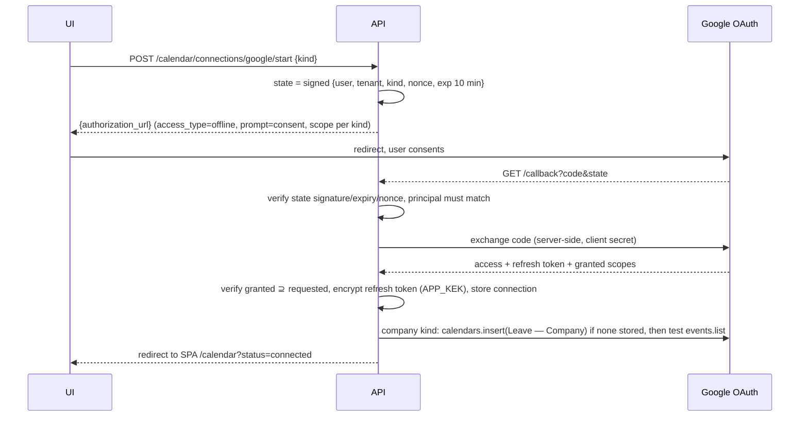
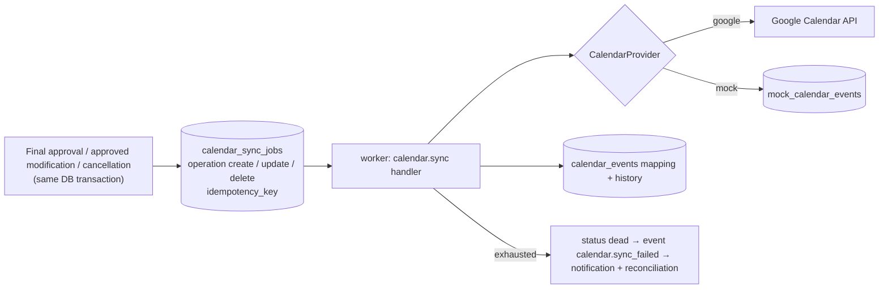
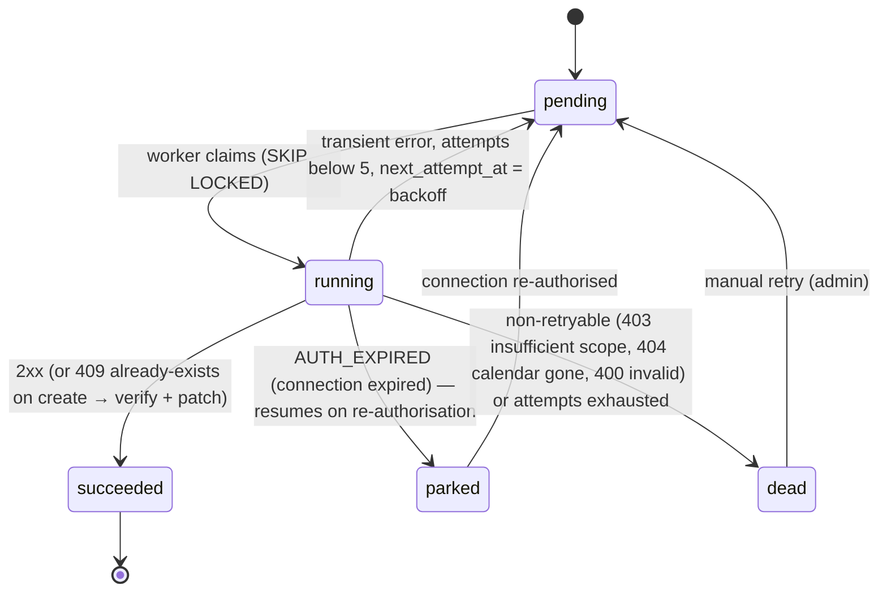

# 10 — Google Calendar Integration

Brief §10.1–10.2: shared company leave calendars and optional personal calendars via OAuth2; events expose only
employee name, absence dates and availability; automatic synchronisation after final approval with retries,
idempotency, history, failure tracking and manual reconciliation; real adapter plus a mock usable in tests.
ADR-0020.

## 1. Connection types

| Kind | Who authorises | Target calendar | Scope (least privilege; verified at M8) | Events written |
|------|----------------|-----------------|------------------------------------------|----------------|
| `company_shared` | Company Administrator (one per tenant) | A secondary calendar created by the app ("Leave — {Company}") in the admin's Google account; sharing to staff is configured by the admin in Google | `https://www.googleapis.com/auth/calendar.app.created` (manage calendars the app created); fallback `…/auth/calendar` if unavailable | every finally-approved absence of the tenant |
| `personal` | Employee (optional) | the employee's `primary` calendar | `https://www.googleapis.com/auth/calendar.events.owned` (events on calendars the user owns); fallback `…/auth/calendar.events` | only the employee's own absences |

Mock provider (`CALENDAR_PROVIDER=mock`) implements the same port with a database-backed fake; it is the default in
development and CI when no Google credentials are configured.

## 2. OAuth2 flows (backend-driven)

- `prompt=consent` + `access_type=offline` guarantees a refresh token on every authorisation (Google only returns
  one on first consent otherwise).
- Refresh tokens are stored encrypted (AES-256-GCM, wrapped by `APP_KEK`); access tokens are kept in memory only.
- **Testing publishing status** (Google Cloud consent screen): refresh tokens expire after 7 days and the app is
  limited to 100 test users. This is acceptable for a local demo; the design treats expiry as a first-class state:
  `invalid_grant` on refresh → connection `expired` → event `calendar.connection_expired` → notification with a
  re-authorise link → pending sync jobs are parked and resume automatically after re-authorisation.
- **Decided (Q-06):** the developer's own Google account owns the Cloud project and the OAuth client; each tenant's
  company calendar is a secondary calendar created by the app in that account (isolated by calendar ID); the mock
  adapter stays the default and the Google adapter is opt-in.
- Revocation: `DELETE /calendar/connections/{id}` calls Google's revoke endpoint, deletes tokens, and marks the
  app's events as `orphaned` (not deleted from Google — the user owns their calendar).

## 3. Event mapping (privacy by design)

| Field | Company shared calendar | Personal calendar |
|-------|-------------------------|-------------------|
| `summary` | `"{First Last} — Out of office"` / `"{Όνομα Επώνυμο} — Εκτός γραφείου"` (tenant default locale) | `"Out of office"` / `"Εκτός γραφείου"` |
| `start.date` / `end.date` | all-day; `end.date = end_date + 1 day` (exclusive per API) | same |
| `description` | `"Approved absence. Availability: unavailable."` | same |
| `transparency` | `transparent` (does not block the admin's own availability) | `opaque` (shows the employee as busy) |
| `visibility` | `default` | `default` |
| `extendedProperties.private` | `{ "app": "leave-assistant", "tenant_id", "leave_request_id", "payload_hash", "version" }` | same |
| `id` | deterministic: `la` + base32hex(request UUID + connection kind) → lowercase `[a-v0-9]`, length ≤ 1024 | same |

Never included: leave type, reason, supporting documents, department, approver names. Name changes re-sync the
summary (P3).

## 4. Synchronisation pipeline (outbox)

- One job per `(request, connection, operation)`; `idempotency_key = sha256(request_id, connection_id, operation,
  payload_hash)` so repeated approvals/modifications never create duplicate jobs.
- Which connections: the tenant's `company_shared` (if active) and the employee's `personal` (if active). An employee
  who connects a personal calendar later gets backfill jobs for future approved absences (P2).

### 4.1 Job state machine

Backoff: 1 min, 5 min, 15 min, 1 h, 4 h (jittered); HTTP 429/503 honour `Retry-After`. Error classes:
`TRANSIENT` (5xx, 429, network, timeouts), `AUTH_EXPIRED` (`invalid_grant`, 401), `PERMANENT` (400/403/404 on the
calendar), `UNKNOWN` (treated as transient twice, then dead).

### 4.2 Idempotent operations
| Operation | Call | Idempotency |
|-----------|------|-------------|
| create | `events.insert` with client-generated `id` | 409 → fetch, compare `payload_hash`; patch if different; record external id |
| update | `events.patch(external_event_id)` | payload hash stored; no-op if unchanged; 404 → treat as missing → create |
| delete | `events.delete(external_event_id)` | 404/410 → already deleted → success |

## 5. Reconciliation (brief: "automatic synchronisation with manual reconciliation")

- Daily (n8n W5 → `POST /internal/calendar/reconcile`) and on demand by a Company Administrator.
- For each active connection: `events.list` with `privateExtendedProperty=app=leave-assistant` in a window of
  −30/+365 days (single-page fetches; paginated if needed) → compare with the expected set (approved, future or
  recent requests):

| Finding | Meaning | Automatic action | Manual options |
|---------|---------|------------------|----------------|
| `missing` | expected event not in Google | enqueue `create` | — |
| `mismatched` | payload hash differs | enqueue `update` | — |
| `orphaned` | app event in Google without an approved request (e.g., cancelled while connection was expired) | enqueue `delete` **only** if the request is known and cancelled; otherwise flag | delete orphan / ignore / relink |
| `unknown_external_id` | mapping lost | flag | relink (set external id) |

- The report (`calendar_reconciliation_reports`, P2 table or `jobs.outcome`) is shown in the admin UI with
  per-item actions; all actions are audited.

## 6. Mock provider
- `MockCalendarProvider` stores events in `app.mock_calendar_events` (tenant-scoped) and implements list/insert/patch/
  delete with the same semantics, including deterministic IDs and 409-on-duplicate.
- Failure injection for tests: `MOCK_CALENDAR_FAIL_MODE=none|transient_once|auth_expired|permanent` and a per-request
  override header in test mode; used by the retry/parking/dead-letter tests and by the UI reconciliation screens in
  development.
- The Google adapter is tested with recorded HTTP fixtures (`respx`) for error classification and payload mapping;
  a manual end-to-end checklist with a real Google account is part of M8's exit criteria.

## 7. Failure visibility
- Connection card (employee/admin): status `active|expired|revoked`, last success, last error, re-authorise button.
- Sync jobs table (admin; employees see their own requests' jobs): status, attempts, next attempt, error class, retry.
- Notifications: `calendar.connection_expired` (to the authoriser), `calendar.sync_failed` (to company admins).
- Health: `/platform/health` shows counts of `dead` and `parked` jobs per tenant.

## 8. Limits and quotas
Google Calendar API quotas are far above this application's volume (tens of events per day); no batching is needed.
The worker processes calendar jobs with concurrency 2 to stay polite under retries.
