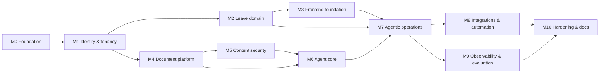

# 12 — Implementation Roadmap and Milestones

Methodology (brief §14): architecture first (this package), then small milestones, each with actionable tasks,
tests written early (TDD for domain logic), review, documentation updates and a worklog entry. Claude Code is
the development assistant; engineering accountability stays with the engineer: every milestone ends with a
human review of code, tests and docs, and results are recorded only when produced.

Sizes are relative (S ≈ 1–2 working sessions, M ≈ 3–5, L ≈ 6–10, XL > 10). No calendar dates are promised.

## 1. Dependency graph

## 2. Milestones

### M0 — Foundation (S) — **done 2026-11-04** (worklog: `docs/development/worklog/M0.md`)
Goal: a reproducible skeleton that builds, lints and runs the core infrastructure.
- Repo layout (doc 03 §4.1), `backend/pyproject.toml` with the cross-validated pins (doc 02 §9) and `uv.lock`;
  Python 3.14 base image; `frontend/` Vite + TS + Ant Design scaffold; `deploy/compose.yaml` with profiles and
  healthchecks for postgres (pg18), keycloak, seaweedfs, mailpit; `.env.example`; Makefile; pre-commit (ruff,
  mypy, eslint); import-linter contracts; CI workflow skeleton (optional).
- Docs: `docs/operations/installation.md` (first version), worklog started, ADR index.
- Exit: `docker compose --profile core up` brings up infra with green healthchecks; `make lint test-unit` pass on
  an empty-but-structured codebase; `uv sync` succeeds on Python 3.14 (import smoke test in CI).

### M1 — Identity, tenancy, audit, seed (M) — **done 2026-11-05** (worklog: `docs/development/worklog/M1.md`)
- Keycloak realm export (clients, roles, groups, mappers, dev users); JWT validation; `Principal`; `/me`.
- Alembic baseline: schemas, roles, `platform.tenants`, `app.departments/employees/employee_roles`, `audit.audit_log`,
  RLS helper + meta-test; transaction-scoped context; pool leak test.
- Tenant provisioning service (Keycloak Admin API + DB); platform endpoints for tenants; bootstrap of the first Company
  Administrator with a temporary password and forced change (Q-12); company admin employee CRUD.
- Seed script with two companies, departments, users (both locales).
- Exit: security suite for tenancy and authorization matrix green; seed runs idempotently; `/me` returns correct
  principals for all five roles; audit entries written for admin actions.

### M2 — Leave domain (L) — TDD — **done 2026-11-05** (worklog: `docs/development/worklog/M2.md`)
- Domain: leave types/policies, holidays, working-day service, ledger, balance view, validation, approval rules
  engine (incl. sick-leave auto-acknowledgement and HR review routing, manager-own-request routing, HR fallback —
  decided Q-01–Q-03), state machine, request/modify/cancel services, approval services, idempotency keys, events.
- API: `/leave/*`, `/approvals/*`, `/team/*`, admin endpoints for types/policies/holidays/rules/simulate, ledger
  adjustments.
- Notifications (records only) for the core events; outbox events emitted.
- Exit: unit + property tests for the domain; API tests for every endpoint incl. problem types; approval
  simulation endpoint matches the engine; idempotency tests; ledger invariants; seed includes balances and a few
  requests in various states.

### M3 — Frontend foundation (M) — **done 2026-11-05** (worklog: `docs/development/worklog/M3.md`)
- Auth (PKCE), layout, role-based navigation, i18n (EL/EN), generated API client, error handling.
- Employee: balance, request wizard (validate → submit), history; Manager: pending approvals, team availability;
  Company admin: employees, departments, holidays, approval rules, policies; Platform admin: tenants.
- Exit: Playwright smoke (login as each role; submit → approve flow); Vitest for critical components; no business
  logic in the frontend (review checklist).

### M4 — Document platform (L) — **done 2026-11-05** (worklog: `docs/development/worklog/M4.md`)
- Storage port + SeaweedFS adapter + local adapter; upload endpoints with validation; document/version tables;
  jobs table + worker process (+ embedded mode); Docling parser with Tesseract CLI OCR (fixture PDFs incl. a scanned
  Greek page); structure normalisation; chunker (tests with EL/EN fixtures); e5 embeddings; pgvector + FTS indexing;
  `RetrievalService` (hybrid + RRF) without reranker; citations endpoint; document UI (library, upload, versions).
- Exit: ingest the seed corpus end-to-end; retrieval integration tests (tenant/visibility predicates); FTS Greek
  stemming test; NFR-PERF-02 measured and recorded; supersede logic tested.

### M5 — Content security and privacy (L) — **done 2026-11-05** (worklog: `docs/development/worklog/M5.md`)
- Presidio engine (EL/EN) + Greek recognisers + known-entity dictionary; vault; LLM-safe text column; re-identification
  policy; injection heuristics + similarity classifier + optional judge; risk scoring; tiers and `security_policies`;
  review queue + quarantine UI; supporting documents (encrypted storage, HR access, audit); retention policies and
  review items (scan job, HR decisions).
- Exit: PII suite (incl. checkpoint/log leak tests); injection families in EL/EN → expected tiers; false-positive
  rate on benign corpus measured; supporting-document isolation tests; retention workflow tests.
- Delivered as planned except: the LLM judge is a port with an inert adapter until M6; the security-policy UI is
  M10; checkpoint leak tests belong to M6 (no checkpointer yet); the similarity classifier scores a contrastive
  margin (doc 08 §8.6) instead of a raw calibrated similarity.

### M6 — Agent core: knowledge (L) — **done 2026-11-06** (worklog: `docs/development/worklog/M6.md`)
- Provider router (Gemini, Groq, Fake) with failover, health, budgets, structured outputs; prompt files; LangGraph
  orchestrator + ingress/classify/compose; Knowledge subgraph; reranker port (candidate A wired, B available);
  Postgres checkpointer (schema/role); conversations + messages; chat API with SSE; streaming re-identification;
  chat UI with citations; Langfuse handler with masking (profile optional).
- Exit: S01–S09 pass with the fake provider; live smoke with both providers; failover tests; budgets asserted;
  restart test for checkpointer; NFR-PERF-01 measured.
- Delivered as planned except: the reranker's running default is candidate B (A is wired but unusable on the
  reference host, doc 13 R-31); 10 rerank candidates at 256 tokens instead of 20 at 512 (doc 05 §6.7); answers are
  streamed after citation verification, not token by token from the model (doc 04 §4.1); business intents get a
  templated pointer to the UI until M7; NFR-PERF-01 is marginally missed (p50 3.12 s, R-31); Mistral replaced Groq as
  the second provider because the Groq signup was blocked (user decision; Groq stays selectable, untested live); the
  live smoke and the forced failover ran on Gemini and Mistral; Langfuse traces need the M9 `observability` profile.

### M7 — Agentic operations: business + approval (L) — **done 2026-11-06** (worklog: `docs/development/worklog/M7.md`)
- Tool catalogue + gateway; Business Operations subgraph; proposals; Approval subgraph with interrupts; resume API;
  execution via services; notifications; manager/HR chat flows; confirmation card UI; run history endpoint.
- Exit: S10–S21, S24–S29 pass with the fake provider; unauthorized-action rate 0 in the security suite; duplicate
  and restart scenarios green; headline scenario demonstrated live.
- Delivered as planned except: tools are bound per intent group as well as per role (JSON schemas cost ≈ 1,300
  e5 tokens for the self-service set; the tool-schema budget is 1,300, not 200); `validate_leave_request` stays in
  the catalogue but is not bound (prepare validates); S13 uses the Christmas holidays instead of New Year (next-year
  booking before rollover, R-32); the business scenarios run on the freshly seeded integration database instead of
  the dev database; user input is screened against its own benign set (`benign_user_v1`). Found and fixed on the
  way: the M6 history duplication in subgraphs, the unscheduled M6 conversation cleanup, request numbers detected as
  phone numbers, and "New conversation" falling back to the latest conversation in the chat page.

### M8 — Integrations and automation (M) — **done 2026-11-06** (worklog: `docs/development/worklog/M8.md`)
- Calendar port, mock + Google adapters, OAuth flows, sync outbox + worker handler, reconciliation + UI; n8n Compose
  profile with init import; workflows W0–W7 as JSON; Mailpit; notification rendering/dispatch; retention and
  housekeeping schedules; provider health digest.
- Exit: mock-based calendar tests (retry/parking/dead/reconcile); manual Google end-to-end checklist completed and
  recorded; Compose E2E: upload → process → e-mail captured in Mailpit; n8n JSON validated; licence note re-verified.
- Delivered as planned except: the manual Google checklist is **pending** (no OAuth client was provided; the adapter
  is covered by recorded-response tests); the outbox is delivered with a lease instead of a cursor; the backend
  creates all business notifications and n8n adds e-mail, reminders, schedules and the digest; W1 is a scheduled
  sweep instead of a per-upload wait (the fire-and-forget sub-workflow call failed on n8n 2.46.6); the OAuth state is
  a hashed single-use nonce. Found and fixed on the way: the outbox grant, notification dedupe, the n8n heap, W4
  ending without output, document notifications without e-mail, and the M6 tanh test reaching MKL itself.

### M9 — Observability and evaluation (M)
- Langfuse profile (ClickHouse, Valkey, SeaweedFS blobs) documented and tested in the evaluation-session
  configuration on the 7 GB reference machine (`make eval-session`, decided Q-05); dataset `leave-eval-v1` in Langfuse; harness for retrieval metrics (pgvector vs Chroma × rerankers ×
  hybrid/vector); RAGAS runs; agent/security metrics; latency measurements; the retrieval-comparison report and the
  reranker decision (ADR-0014 updated with results); evaluation docs.
- Exit: `docs/evaluation/*` contain actual results with configuration and date; default backend/reranker set from
  evidence; known weaknesses listed.

### M10 — Hardening and documentation completion (M)
- Platform admin UI completion, security policy UI, audit export, backup/restore script and test, resource limits
  and `WORKER_MODE=embedded` validation on the 7 GB machine, troubleshooting guide, final ADR sync, README.
- Exit: clean-clone install test following only the docs; all suites green; documentation review against brief §13.

## 3. Task breakdown examples (first two milestones)

M0 tasks: T0.1 repo layout + Makefile · T0.2 backend package skeleton with config and health endpoints · T0.3
`pyproject` + `uv.lock` (Python 3.14) + CPU torch index · T0.4 Dockerfile (python:3.14-slim + tesseract ell/eng,
non-root) · T0.5 Compose core services + healthchecks + volumes · T0.6 frontend scaffold with i18n and auth stub ·
T0.7 lint/type/test tooling and import-linter contracts · T0.8 docs/operations/installation.md · T0.9 worklog entry.

M1 tasks: T1.1 realm export with clients/roles/groups/mappers · T1.2 JWT validation + Principal + `/me` ·
T1.3 Alembic baseline + RLS helper + roles SQL · T1.4 tenant context (contextvar → SET LOCAL) + leak test ·
T1.5 authorization policy + matrix tests · T1.6 provisioning service (Keycloak Admin API) + platform tenant endpoints ·
T1.7 employee/department admin endpoints · T1.8 audit service + log scrubbing · T1.9 seed script (two companies) ·
T1.10 security suite (tenancy) · T1.11 docs: security §4–§6 verified against implementation, worklog.

## 4. Definition of done (every task)
Code + tests + docs in the same change; lint/type clean; no new `skip`; secrets untouched; audit for new
state-changing operations; i18n keys for new UI strings; ADR updated if a decision changed; worklog line.

## 5. Working with Claude Code (process notes, brief §14)
- Each task is given with: the relevant doc sections, acceptance tests to write first, files expected to change,
  and explicit non-goals.
- The assistant proposes; the engineer reviews diffs and test output; nothing is marked done without executed tests.
- Deviations from this package are recorded as ADR amendments or new ADRs before implementation continues.
- `docs/development/worklog/` receives one entry per milestone: what was built, what changed versus the plan and
  why, problems encountered and how they were solved.
